# DA_Review-News-RAG

**리뷰 텍스트 분석 · 뉴스 제목 분류 · RAG FAQ 챗봇(+ LLM Wiki)** — 텍스트 데이터를 수집부터 분석, 분류, 대시보드, 질의응답 시스템까지 끝까지 이어서 만든 실습 프로젝트입니다.

## 30초 요약

**한 줄:** 정답 라벨이 없는 리뷰 텍스트를 LLM으로 분류하고, 정답이 있는 뉴스 제목은 지도학습으로 분류하고, 문서에 근거해서만 답하는 RAG 챗봇까지 — 텍스트 데이터 분석을 수집부터 서비스 화면까지 이어서 만들었습니다.

| | 핵심 결과 |
|---|---|
| **1. 리뷰 분석** | 헤어 디퓨저 리뷰 1,319건을 6개 항목(장착·접힘·파손·열·휴대성·건조 결과)과 감정으로 분류했습니다. **접힘의 87.3%, 파손의 92.6%가 불만**이고, **휴대성은 90.8%가 칭찬**, 장착/고정은 호불호가 반반(긍정 44.5% · 부정 44.7%)입니다. 판단이 모호한 141건은 "검토 필요"로 남겨 대시보드에서 사람이 확인하게 했습니다. |
| **2. 뉴스 분류** | 뉴스 제목 7개 주제를 TF-IDF + 로지스틱 회귀로 분류해 **검증 정답률 81.5%**. 확률 임계값을 0.7로 올리면 분류된 건의 정답률이 **92.0%** 로 오르지만 34.7%는 보류됩니다(정답률 ↔ 처리량 트레이드오프). |
| **3. RAG 챗봇** | 로컬 임베딩 3종을 비교해 **정답 문서가 상위 4위 안에 드는 비율 97%**(e5-large)를 달성하고, **출처를 보여 주며 문서에 없으면 "확인할 수 없음"** 으로 답합니다. 문서를 LLM Wiki로 정리해 연결했고, **API 키·유료 과금 없이** 동작합니다. |

**기술:** Python · pandas · scikit-learn · BERTopic(UMAP·HDBSCAN) · sentence-transformers · LangChain · Chroma/FAISS · Streamlit · Plotly · Claude(LLM 분류·답변 생성)

**솔직한 한계:** 리뷰 분류 라벨은 LLM이 붙였고 사람이 교차 검증하지 않았습니다(표본 일치율 94.7%는 정확도가 아니라 일관성). 근거 문장의 약 10%는 라벨을 뒷받침하지 못합니다. 자세한 내용은 [한계와 주의](#한계와-주의)에 있습니다.

<table>
<tr>
<td width="50%">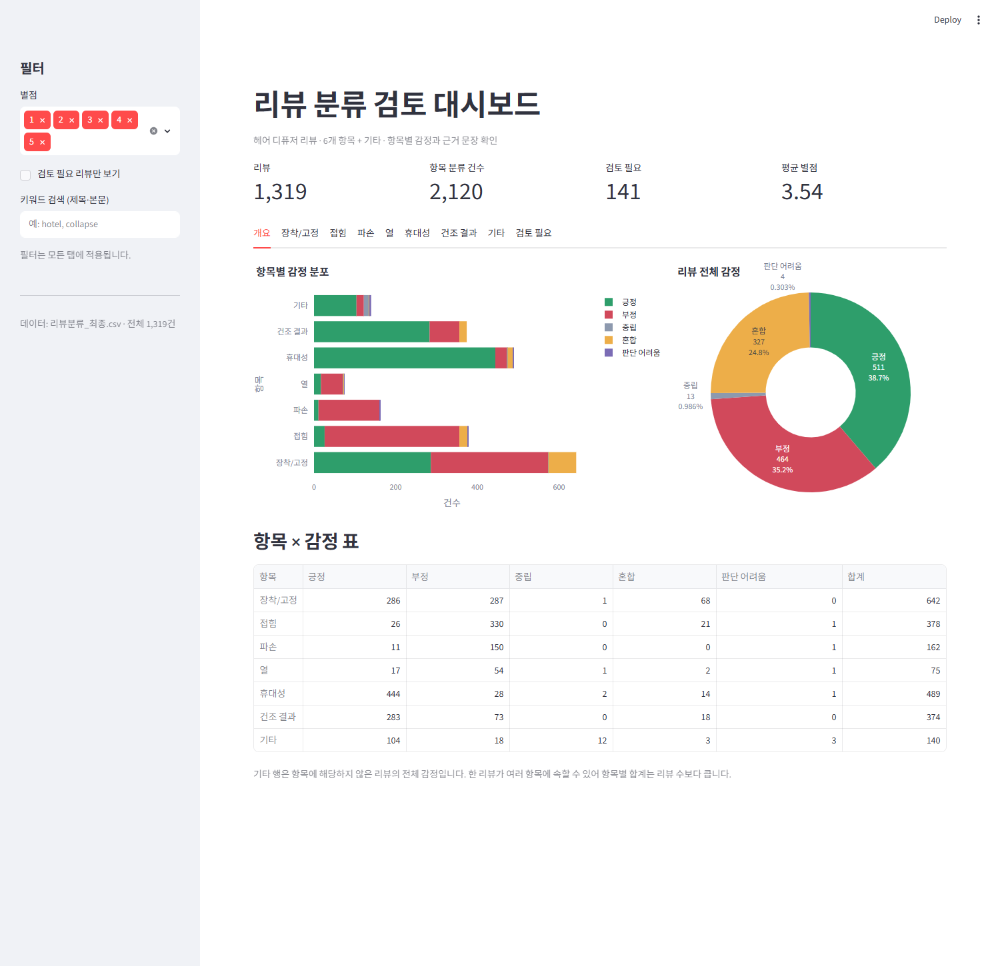<br><sub>리뷰 검토 대시보드 (Streamlit)</sub></td>
<td width="50%">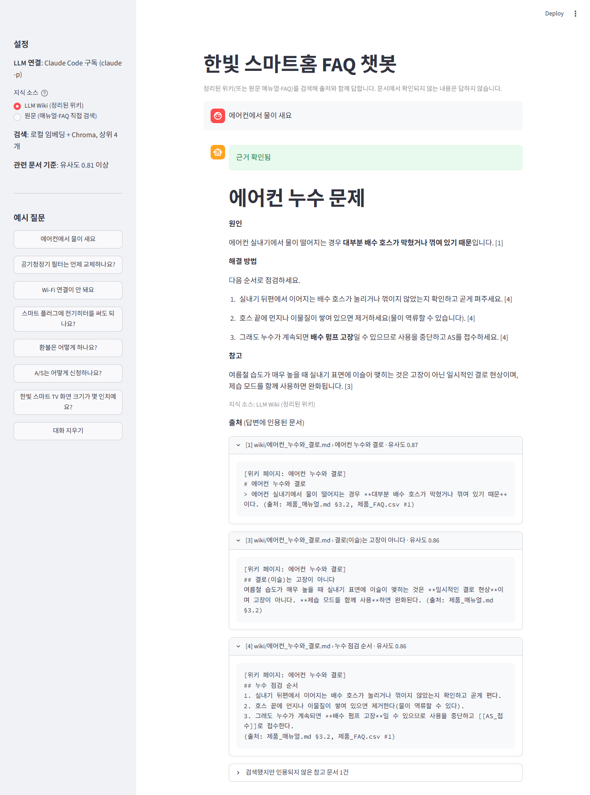<br><sub>출처를 보여 주는 FAQ 챗봇 (Streamlit)</sub></td>
</tr>
</table>

---

## 프로젝트 구성

| 파트 | 데이터 | 한 일 | 결과물 |
|---|---|---|---|
| [1. 리뷰 분석](#part-1-상품-리뷰-분석-헤어-디퓨저) | Amazon 상품 리뷰 1,328건 | 정제 → 임베딩 → BERTopic → 문장 단위 토픽 → 파라미터 튜닝 → 6개 항목·감정 분류 | 분류 표, 근거 문장, **Streamlit 검토 대시보드** |
| [2. 뉴스 분류](#part-2-뉴스-제목-주제-분류-klue-ynat) | KLUE-YNAT 뉴스 제목 54,785건 | TF-IDF + 로지스틱 회귀 7개 주제 분류, 임계값별 혼동행렬 | 정답률 81.5%, 임계값별 정답률·보류 건수 |
| [3. RAG 챗봇](#part-3-rag-faq-챗봇--llm-wiki) | 제품 매뉴얼 + FAQ 15개 | LangChain + 로컬 임베딩 + Chroma, 출처·"확인할 수 없음" 처리, LLM Wiki 구축·연결 | **Streamlit FAQ 챗봇** |

> 모든 수치는 저장소에 들어 있는 CSV에서 읽은 값이고, 차트는 [`tools/make_figures.py`](tools/make_figures.py)가 그 CSV로 다시 그립니다. 화면 캡처는 실제로 앱을 띄워 찍었습니다.

## 목차
1. [저장소 구성](#저장소-구성)
2. [데이터 수집 출처와 구조](#데이터-수집-출처와-구조)
3. [Part 1. 상품 리뷰 분석](#part-1-상품-리뷰-분석-헤어-디퓨저)
4. [Part 2. 뉴스 제목 주제 분류](#part-2-뉴스-제목-주제-분류-klue-ynat)
5. [Part 3. RAG FAQ 챗봇 + LLM Wiki](#part-3-rag-faq-챗봇--llm-wiki)
6. [실행 방법](#실행-방법)
7. [한계와 주의](#한계와-주의)

---

## 저장소 구성

```
DA_Review-News-RAG/
├─ README.md
├─ requirements.txt              전체 파트 공통 패키지
├─ tools/
│   ├─ make_figures.py           README 차트 생성 (CSV → docs/img/fig*.png)
│   └─ capture_screens.py        대시보드·챗봇 화면 캡처 (Playwright)
├─ docs/img/                     README용 차트·화면 캡처
├─ 01_review_analysis/           Part 1
│   ├─ data/raw/                 원본 리뷰 CSV + 출처 메타데이터(data_info.json, product.json)
│   ├─ data/processed/           정제본, 1~3점 주제 결과, 문장 분리·토픽 결과
│   ├─ outputs/tables/           분류 기준표, 최종 분류 결과, 검토 필요 목록, 튜닝 결과 등
│   ├─ outputs/figures/          BERTopic 산점도
│   ├─ outputs/report/           BERTopic 분석 HTML 보고서(인터랙티브)
│   └─ dashboard/                Streamlit 리뷰 검토 대시보드
├─ 02_news_classification/       Part 2 (analysis/ 스크립트, outputs/ 표·그림)
└─ 03_rag_faq_chatbot/           Part 3
    ├─ data/                     제품 매뉴얼.md, FAQ.csv (원본, 수정하지 않음)
    ├─ wiki/                     LLM Wiki (21페이지)
    ├─ ingest.py · ingest_wiki.py · rag_chain.py · app.py
    ├─ wiki_lint.py              위키 점검 스크립트
    └─ compare_embeddings.py · compare_vectordb.py   모델·벡터DB 비교 실험
```

---

## 데이터 수집 출처와 구조

### 사용한 데이터 3종

| 데이터 | 출처 | 규모 | 수집·확보 시점 | 용도 |
|---|---|---|---|---|
| 상품 리뷰 | [Amazon Reviews 2023](https://amazon-reviews-2023.github.io/) (McAuley Lab, [Hugging Face](https://huggingface.co/datasets/McAuley-Lab/Amazon-Reviews-2023)) · All_Beauty 카테고리 · 상품 1개(ASIN `B019GBG0IE`, *Collapsible Hair Diffuser by The Curly Co.*) | 1,328건 (해당 ASIN의 전체 기록, 표본 추출 없음), 작성 기간 2016-01-18 ~ 2023-08-28 | 2026-10-07 | Part 1 |
| 뉴스 제목 | [KLUE-benchmark](https://github.com/KLUE-benchmark/KLUE) YNAT(연합뉴스 제목 주제 분류) | train 45,678건 / dev 9,107건, 7개 주제 | 2026-10-10 | Part 2 |
| 제품 매뉴얼·FAQ | 실습용으로 제공된 **가상의 샘플 문서**(한빛 스마트홈: 에어컨 HB-AC300, 공기청정기 HB-AP120, 스마트 플러그 HB-PL10) | 매뉴얼 1개(절 17개) + FAQ 15개 | 2026-10-10 | Part 3 |

- 리뷰 원본의 `reviewer_id`는 원본 작성자 ID를 SHA256으로 변환한 앞 16자리라서 중복 점검에만 쓰고, 개인을 식별하지 않습니다.
- 원본은 `01_review_analysis/data/raw/`, `02_news_classification/data/raw/`, `03_rag_faq_chatbot/data/`에 두고 **수정하지 않았습니다.** 가공 결과는 별도 폴더에 저장했습니다.
- KLUE 원본 JSON(train 46MB, dev 9MB)은 용량 때문에 저장소에서 뺐습니다. 파일 해시는 [`source_info.json`](02_news_classification/data/raw/source_info.json)에, 라이선스는 [`KLUE_LICENSE.txt`](02_news_classification/data/raw/KLUE_LICENSE.txt)에 있습니다. 직접 내려받아 같은 위치에 두면 스크립트를 다시 돌릴 수 있습니다.

### 리뷰 데이터 칼럼

| 칼럼 | 설명 |
|---|---|
| review_id | 교육용 리뷰 번호. AB 뒤 숫자는 원본 파일의 행 번호. |
| asin | 해당 상품의 식별자. 모든 행 B019GBG0IE. |
| parent_asin | 관련 상품을 묶는 상위 상품 식별자. 이번에는 asin과 동일. |
| reviewer_id | 원본 작성자 ID를 SHA256으로 변환한 앞 16자리. 중복 점검용. |
| rating | 1~5점 별점 |
| title | 리뷰 제목 |
| text | 리뷰 본문 원문 |
| timestamp | 리뷰 작성 시각, Unix 밀리초. 날짜는 UTC로 해석. |
| verified_purchase | 데이터 제공처의 구매 확인 표시 |
| helpful_vote | 도움이 된다는 투표 수 |


데이터 제공처가 밝힌 한계도 그대로 옮깁니다.
- 같은 ASIN에 연결된 원본 기록이며, 실제 구입 이력이나 상품 결함을 독립적으로 검증한 자료가 아닙니다.
- 현재 Amazon의 전체 리뷰나 전체 구매자를 대표하지 않습니다.
- 원문은 영어 중심이고 스페인어 등 다른 언어도 일부 있어 다국어 임베딩을 사용했습니다.

---

## Part 1. 상품 리뷰 분석 (헤어 디퓨저)

**질문:** 접이식 헤어 디퓨저 리뷰에서 소비자는 무엇에 만족하고 무엇에 불만인가? 정답 라벨이 없는 텍스트를 어떻게 분석하고 분류할 수 있는가?

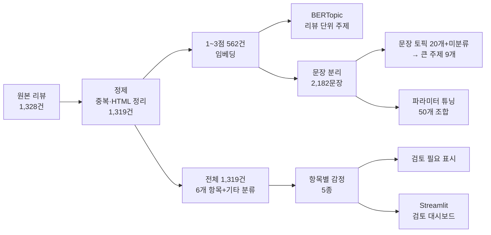

> **재현성 안내:** 이 파트의 분석은 대화형으로 진행해서 정제·BERTopic·튜닝·분류 코드를 스크립트 파일로 남기지 못했습니다. 대신 **각 단계의 입력·출력 CSV와 최종 표를 모두 저장소에 남겼고**, 설정값은 아래와 `data_info.json`에 기록했습니다. 스크립트로 재현할 수 있는 부분은 Part 2·3, 차트 생성, 위키 점검입니다.

### 1-1. 데이터 정제

| 처리 | 기준 | 건수 |
|---|---|---|
| 중복 제거 | 작성자·상품·작성시각·별점·제목·본문이 모두 같으면 같은 리뷰로 보고 1건만 남김 (`review_id` 자체의 중복은 0건) | **9건 제거** |
| 별점 이상치 | 1~5 범위를 벗어난 값을 찾아 별도 출력(제외하지 않음) | **0건** |
| HTML 태그 | 본문의 `<br />` 같은 태그를 지우고 텍스트만 남김 | 83건 정리 |
| HTML 특수문자 | `&amp;`, `&#34;` 등을 원래 기호로 변환 | 39건 정리 |

→ **1,328건 → 1,319건.** 정제 후 본문·제목에 남은 태그·특수문자는 0건입니다. (본문이 비어 있는 리뷰 1건은 제외하지 않고 그대로 두고 "본문 없음"으로 검토 대상에 표시했습니다.)

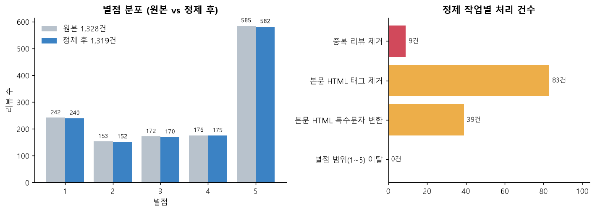

| 별점 | 원본 | 정제 후 | 정제 후 비율 |
|---|---:|---:|---:|
| 1 | 242 | 240 | 18.2% |
| 2 | 153 | 152 | 11.5% |
| 3 | 172 | 170 | 12.9% |
| 4 | 176 | 175 | 13.3% |
| 5 | 585 | 582 | 44.1% |


별점은 **5점이 약 44%로 가장 많고, 1~3점은 562건**입니다. 이후 주제 분석은 불만의 원인을 찾기 위해 **1~3점 리뷰 562건**을 대상으로 했고, 분류는 4~5점을 포함한 **전체 1,319건**에 적용했습니다.

### 1-2. 리뷰 임베딩과 BERTopic (리뷰 단위)

1~3점 리뷰 본문을 다국어 문장 임베딩(`paraphrase-multilingual-MiniLM-L12-v2`, 384차원)으로 숫자 벡터로 바꿔, **임베딩과 원문을 한 표에 담은 파생 테이블**(리뷰 ID, 별점, 제목, 본문, 임베딩)을 만들었습니다. 용량(2.3MB 이상) 때문에 저장소에는 넣지 않았습니다.

이 벡터로 BERTopic(UMAP 차원 축소 → HDBSCAN 군집화 → c-TF-IDF 대표 단어)을 돌렸습니다. (교육 자료가 제시한 참고 설정은 [`data_info.json`](01_review_analysis/data/raw/data_info.json)의 `reference_settings`에 있습니다. 이웃 수·최소 군집 크기가 결과에 미치는 영향은 [1-5](#1-5-분석-품질을-높이는-파라미터-탐색-임베딩--이웃-수--최소-군집-크기)에서 따로 탐색했습니다.)

| 주제 | 리뷰 수 | 대표 단어(상위 6개) |
|---|---:|---|
| 이상치 | 11 | head, se, easily, rubber, la, collapses |
| 주제 0 | 351 | hair, diffuser, dryer, fit, hair dryer, use |
| 주제 1 | 100 | dryer, blow, fit, blow dryer, did, product |
| 주제 2 | 100 | use, fell, broke, collapses, apart, using |


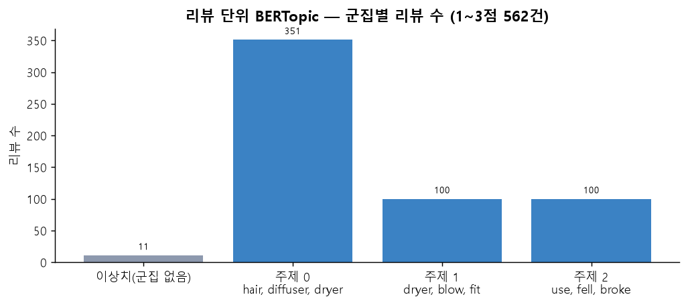

리뷰 전체를 한 덩어리로 보니 **"헤어드라이어에 맞는가"가 가장 큰 주제(351건)**이고, 그 다음이 블로우 드라이어 호환(100건), 사용 중 접힘·부서짐(100건)이었습니다. 군집에 들어가지 못한 리뷰는 11건이었습니다.

아래는 임베딩을 2차원으로 줄여 펼친 산점도입니다(시각화용). **왼쪽은 참고 설정(`min_cluster_size=20`)의 4개 그룹, 오른쪽은 10으로 낮춰 더 잘게 나눈 결과**(주제 0·1은 그대로고, 주제 2의 100건이 76건 + 새 군집 19건으로 갈라지고 5건은 미분류로 빠져 미분류가 11건에서 16건이 됨)입니다. 인터랙티브 보고서는 [`리뷰분석_보고서.html`](01_review_analysis/outputs/report/리뷰분석_보고서.html)에 있습니다.

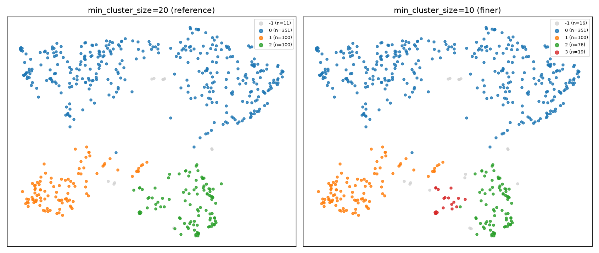

한 리뷰 안에 "잘 맞지만 접힌다"처럼 여러 이야기가 섞여 있어 **리뷰 단위 군집은 주제가 뭉뚱그려집니다.** 그래서 다음 단계에서 문장으로 쪼갰습니다.

### 1-3. 문장 단위 토픽 모델링

1~3점 리뷰 562건을 **문장 단위로 분리해 2,182문장**으로 만들고, 각 문장에 원래 리뷰 ID를 붙였습니다(`sentence_id` = 리뷰 ID + 문장 번호).
- `:unamused:` 같은 이모지 코드는 제외했습니다.
- `and`·`but` 등으로 이어진 문장은 따로 나눴습니다.

문장 임베딩(MiniLM-L12)으로 다시 BERTopic을 돌려 **토픽 20개 + 미분류 1개**를 얻고, 토픽마다 주제 이름을 추천해 정리했습니다. (미분류 = HDBSCAN이 어느 군집에도 넣지 않은 문장)

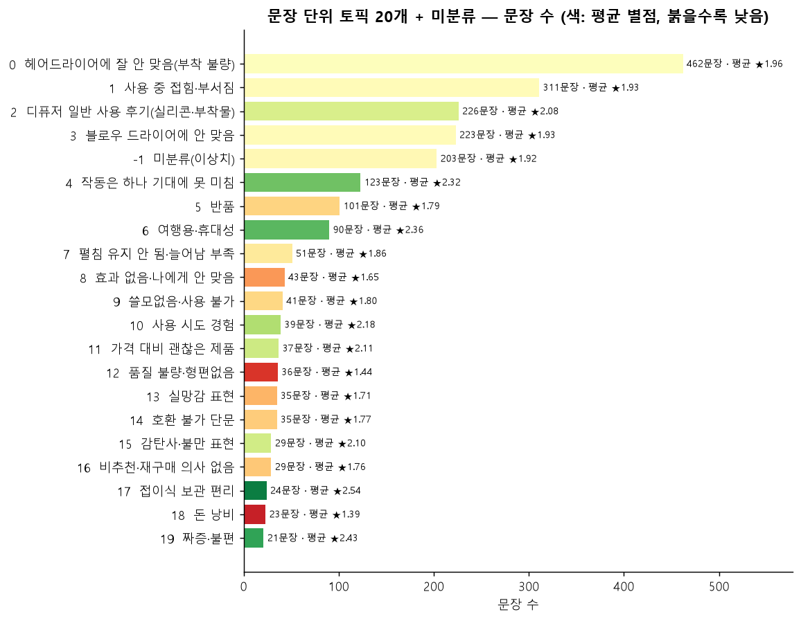

| 토픽 | 추천 주제 | 문장 수 | 리뷰 수 | 평균 별점 | 대표 단어(상위 8개) |
|---|---|---:|---:|---:|---|
| -1 | 미분류(이상치) | 203 | 152 | 1.92 | product, dont, stars, waste, universal, dont waste, use, cheaply |
| 0 | 헤어드라이어에 잘 안 맞음(부착 불량) | 462 | 298 | 1.96 | hair, hair dryer, dryer, fit, hairdryer, fit hair, curly, dry |
| 1 | 사용 중 접힘·부서짐 | 311 | 237 | 1.93 | collapses, use, fell, collapsing, using, easily, apart, broke |
| 2 | 디퓨저 일반 사용 후기(실리콘·부착물) | 226 | 148 | 2.08 | diffuser, silicone, diffuser diffuser, like, attachment, dryer, diffusers, use |
| 3 | 블로우 드라이어에 안 맞음 | 223 | 181 | 1.93 | dryer, blow, blow dryer, fit, fit blow, dryers, fit dryer, does |
| 4 | 작동은 하나 기대에 못 미침 | 123 | 101 | 2.32 | great, works, job, good, love, idea, wanted love, wanted |
| 5 | 반품 | 101 | 84 | 1.79 | return, returned, returning, item, immediately, contact, missed, window |
| 6 | 여행용·휴대성 | 90 | 75 | 2.36 | travel, traveling, great traveling, bought, trip, great, space, collapsible |
| 7 | 펼침 유지 안 됨·늘어남 부족 | 51 | 49 | 1.86 | extended, stretch, doesnt, stay, stay extended, doesnt stay, isnt, hold |
| 8 | 효과 없음·나에게 안 맞음 | 43 | 40 | 1.65 | work, didnt, doesnt work, did, doesnt, hoped, didnt help, like |
| 9 | 쓸모없음·사용 불가 | 41 | 38 | 1.80 | useless, worthless, good, sure, useless useless, practical, unusable, happy |
| 10 | 사용 시도 경험 | 39 | 34 | 2.18 | fingers, used, times, hand, use, used times, ive, tried |
| 11 | 가격 대비 괜찮은 제품 | 37 | 35 | 2.11 | product, good, price, pretty, good product, sturdy, excited, quality |
| 12 | 품질 불량·형편없음 | 36 | 35 | 1.44 | bad, flimsy, sucks, product, quality, horrible, terrible, really |
| 13 | 실망감 표현 | 35 | 34 | 1.71 | disappointed, disappointed disappointed, disappointing, disappointing im, im, disappointed im, disappointed disappointing, pretty disappointed |
| 14 | 호환 불가 단문 | 35 | 32 | 1.77 | fit, doesnt, doesnt fit, fit doesnt, did fit, fit does, fit fit, fit isnt |
| 15 | 감탄사·불만 표현 | 29 | 21 | 2.10 | ugh, beware boo, beware, boo let, booo, deal read, diffuses okay, esther maxemow |
| 16 | 비추천·재구매 의사 없음 | 29 | 28 | 1.76 | recommend, buy, wouldnt recommend, wouldnt, buying, favorite, buy wouldnt, recommend buying |
| 17 | 접이식 보관 편리 | 24 | 24 | 2.54 | collapsible, storage, nice, collapsible love, compact, love collapsible, love, like collapsible |
| 18 | 돈 낭비 | 23 | 23 | 1.39 | money, waste, waste money, worth, money worth, money waste, worth money, wasnt worth |
| 19 | 짜증·불편 | 21 | 21 | 2.43 | annoying, frustrating, pain, frustrating annoying, just annoying, annoying annoying, annoying deal, annoying frustrated |


### 1-4. 비슷한 토픽을 묶어 큰 주제 9개로

토픽 20개는 많아서, 의미가 비슷한 것끼리 묶어 **10개 미만(9개)** 으로 줄였습니다.

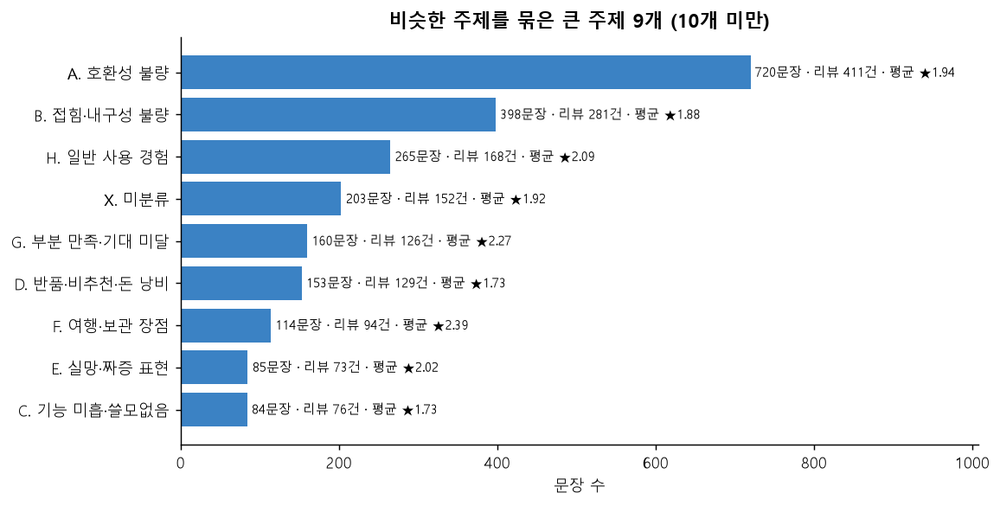

| 기호 | 큰 주제 | 묶은 토픽 | 문장 수 | 리뷰 수 | 평균 별점 | 주요 단어 |
|---|---|---|---:|---:|---:|---|
| A | 호환성 불량 | 0,3,14 | 720 | 411 | 1.94 | hair, dryer, fit, blow, did, does, drying, curly |
| B | 접힘·내구성 불량 | 1,7,12 | 398 | 281 | 1.88 | collapses, use, using, collapsing, fell, easily, apart, broke |
| C | 기능 미흡·쓸모없음 | 8,9 | 84 | 76 | 1.73 | work, didn, useless, doesn, good, like, worthless, hoped |
| D | 반품·비추천·돈 낭비 | 5,16,18 | 153 | 129 | 1.73 | return, money, recommend, waste, worth, item, buy, immediately |
| E | 실망·짜증 표현 | 13,15,19 | 85 | 73 | 2.02 | disappointed, annoying, disappointing, frustrating, ugh, pain, sad, pretty |
| F | 여행·보관 장점 | 6,17 | 114 | 94 | 2.39 | travel, collapsible, great, bought, trip, space, nice, compact |
| G | 부분 만족·기대 미달 | 4,11 | 160 | 126 | 2.27 | great, product, good, works, love, job, idea, wanted |
| H | 일반 사용 경험 | 2,10 | 265 | 168 | 2.09 | diffuser, silicone, used, dryer, ve, like, attachment, fingers |
| X | 미분류 | -1 | 203 | 152 | 1.92 | product, don, use, waste, universal, stars, like, just |


큰 주제별 대표 문장(원문)입니다.

| 기호 | 큰 주제 | 대표 문장 예시(원문) |
|---|---|---|
| A | 호환성 불량 | "This doesn't fit that well on my hair dryer." |
| B | 접힘·내구성 불량 | "But it collapses while in use." |
| C | 기능 미흡·쓸모없음 | "Not usable." |
| D | 반품·비추천·돈 낭비 | "I returned it" |
| E | 실망·짜증 표현 | "So disappointed." |
| F | 여행·보관 장점 | "it’s collapsible for travel" |
| G | 부분 만족·기대 미달 | "Otherwise it works great." |
| H | 일반 사용 경험 | "I've used this diffuser less than 20 times so far" |
| X | 미분류 | "Was not a fan of this product." |


**읽는 법:** 불만은 크게 **(A) 드라이어에 안 맞음 720문장 + (B) 접힘·내구성 398문장**으로 쏠려 있습니다. 평균 별점이 가장 낮은 주제는 **반품·비추천·돈 낭비(1.73)** 와 **기능 미흡·쓸모없음(1.73)** 이고, 같은 1~3점 리뷰 안에서도 **여행·보관 장점(2.39)** 처럼 장점을 말하는 문장이 있었습니다.

### 1-5. 분석 품질을 높이는 파라미터 탐색 (임베딩 × 이웃 수 × 최소 군집 크기)

품질에 영향을 주는 세 요인을 바꿔 가며 **총 50개 조합**(임베딩 2종 × UMAP 이웃 수 5종 × 최소 군집 크기 5종)을 모두 돌렸습니다.

| 요인 | 후보 |
|---|---|
| 1. 임베딩 모델 | MiniLM-L12(384차원), mpnet-base(768차원) |
| 2. UMAP 이웃 수(`n_neighbors`) | 5, 10, 15, 30, 50 |
| 3. 최소 군집 크기(`min_cluster_size`) | 10, 15, 20, 30, 40 |

정답 라벨이 없어서 군집이 얼마나 뚜렷하고 해석하기 쉬운지를 지표로 봤습니다.

- **실루엣:** 군집 안은 가깝고 군집 사이는 먼 정도(높을수록 좋음)
- **일관성(NPMI):** 군집의 주요 단어가 같은 문장에 함께 나오는 정도. 짧은 문장이라 값이 모두 음수이므로 조합 간 **상대 비교**로만 사용
- **다양성:** 군집 간 주요 단어가 겹치지 않는 비율
- **미분류 비율:** 낮을수록 좋음
- **종합 점수:** 위 네 지표를 0~1로 맞춰 실루엣 30%, 일관성 30%, 다양성 20%, 미분류 20%로 합침 (**이 가중치는 임의로 정한 것**)
- **후보 조건:** 군집 6~20개, 최대 군집이 전체의 35% 이하, 미분류 20% 이하 → 50개 중 **17개 통과**

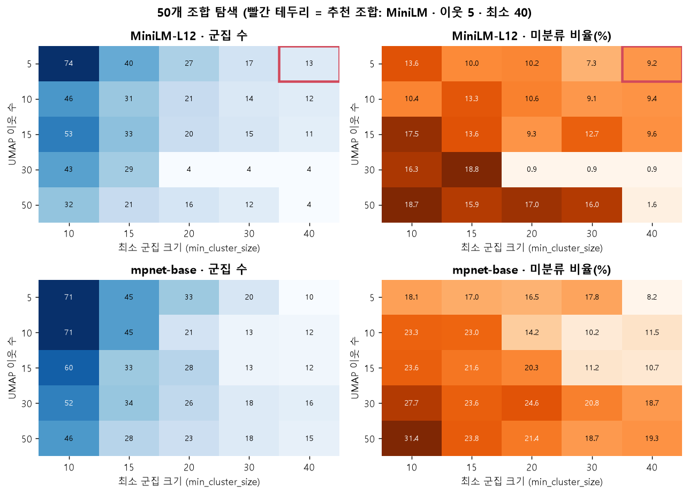

위 히트맵에서 보이는 경향:
- **이웃 수 30**에서는 군집이 4개로 뭉치는 조합이 많았습니다(대부분의 문장이 한 군집에 쏠림) → 후보에서 제외.
- **최소 군집 크기 10~15**는 군집이 21~74개로 쪼개져 해석이 어렵고, **40**은 군집 수가 10~16개(이웃 수 30·50의 MiniLM 조합 제외)로 해석할 만한 수준이면서 미분류 비율도 낮았습니다.
- **mpnet(큰 모델)이 MiniLM보다 낫지 않았습니다.** 큰 군집 하나가 생기고(최대 군집 34%) 미분류가 더 많았습니다.

점수 상위 5개를 **무작위 시드를 바꿔 다시 돌려 안정성(ARI)** 도 비교했습니다. ARI는 1에 가까울수록 시드가 달라도 결과가 같다는 뜻입니다.

| 순위 | 임베딩 | UMAP 이웃 수 | 최소 군집 크기 | 군집 수 | 미분류 | 실루엣 | 일관성 | 다양성 | 종합 점수 | 시드 안정성 ARI(평균/최저) |
|---|---|---|---|---|---|---|---|---|---|---|
| 1 | MiniLM-L12 | 10 | 40 | 12 | 9.4% | 0.133 | -0.395 | 0.825 | 0.618 | 0.71 / 0.33 |
| 2 | mpnet-base | 15 | 40 | 12 | 10.7% | 0.136 | -0.450 | 0.900 | 0.603 | 0.41 / 0.36 |
| 3 | MiniLM-L12 | 50 | 30 | 12 | 16.0% | 0.162 | -0.400 | 0.825 | 0.596 | 0.79 / 0.76 |
| 4 | MiniLM-L12 | 15 | 40 | 11 | 9.6% | 0.130 | -0.399 | 0.818 | 0.591 | 0.65 / 0.30 |
| 5 | MiniLM-L12 | 5 | 40 | 13 | 9.2% | 0.119 | -0.397 | 0.838 | 0.586 | 0.85 / 0.81 |


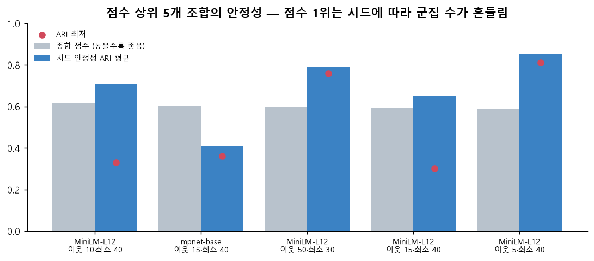

**추천: MiniLM-L12 · 이웃 수 5 · 최소 군집 크기 40 (5위 조합).** 점수 1위(0.618)는 시드를 바꾸면 군집 수가 5·12·11개로 흔들려(ARI 최저 0.33) 해석에 쓰기 어렵고, 5위는 점수 차이가 0.03에 불과한데 시드를 바꿔도 가장 안정적(ARI 평균 0.85, 군집 수 11~14)이었습니다. **점수가 아니라 안정성을 보고 고른 판단**입니다. 이 설정의 결과(군집 13개, 미분류 200문장 = 9.2%)입니다.

| 군집 | 문장 수 | 리뷰 수 | 평균 별점 | 주요 단어 | 대표 문장 1 |
|---|---:|---:|---:|---|---|
| 0 | 468 | 299 | 1.96 | hair, hair dryer, dryer, fit, hairdryer, fit hair, curly, dry | This doesn't fit that well on my hair dryer. |
| 4 | 362 | 263 | 1.93 | collapses, use, using, collapsing, fell, easily, apart, collapse | But it collapses while in use. |
| 2 | 231 | 148 | 2.08 | diffuser, silicone, dryer, diffuser diffuser, like, use, attachment, collapsible | The diffuser works well |
| 1 | 209 | 174 | 1.90 | dryer, blow, blow dryer, fit, dryers, fit blow, fit dryer, does | it would not fit my blow dryer |
| 9 | 154 | 117 | 2.31 | great, works, job, love, idea, wish, good, wanted love | Otherwise it works great. |
| 3 | 99 | 84 | 1.79 | return, returned, returning, item, immediately, returned immediately, missed, contact | I returned it |
| 11 | 92 | 78 | 2.00 | product, bought, buy, trip, recommend, travel, buying, just | I bought this for travel. |
| 10 | 80 | 71 | 1.85 | product, bad, flimsy, really, sure, quality, sucks, good | It's not that great product. |
| 12 | 69 | 60 | 2.54 | travel, traveling, great, great traveling, collapsible, compact, storage, feature | I love that it’s collapsible which is convenient for travel |
| 7 | 65 | 60 | 1.83 | doesn, fit, doesn fit, work, doesn work, didn, fit doesn, isn | it doesn’t fit. |
| 5 | 60 | 58 | 1.95 | disappointed, annoying, disappointing, disappointed disappointed, frustrating, annoying disappointed, pain, got | Pretty disappointed. |
| 8 | 50 | 47 | 1.92 | used, use, fingers, times, hand, time, haven, used times | I even tried placing my hand around it when I use it |
| 6 | 43 | 42 | 1.58 | didn, throw away, throw, work, away, did, didn help, garbage | it didn’t do it for me. |


### 1-6. LLM으로 문서 분류 — 6개 항목 + 기타

**배경:** 정답(라벨)이 없는 데이터로는 지도학습 분류 모델을 만들 수 없습니다. 그래서 먼저 분류 **기준**을 정하고, LLM이 기준에 따라 라벨을 붙이는 방식을 썼습니다.

#### 분류 기준표

리뷰 본문을 보고 아래 6개 항목으로 나누고, 어디에도 해당하지 않으면 **기타**로 분류합니다. 한 리뷰가 여러 항목에 속할 수 있고(multi-label), 항목마다 극성(+ 긍정 / − 부정 / ~ 혼합)을 붙입니다.

| 번호 | 항목 | 정의 | 극성(+/−/~) 기준 |
|---|---|---|---|
| 1 | 장착_고정 | 디퓨저가 드라이어에 끼워지는지, 크기·늘어남이 맞는지, 쓰는 동안 붙어 있는지 빠지는지 | +: 잘 맞고 붙어 있음 / −: 안 맞음·빠짐·끼우기 힘듦 / ~: 힘들게 끼웠으나 사용 가능, 일부 드라이어에만 맞음 |
| 2 | 접힘 | 사용 중(말리는 동안) 디퓨저가 접히거나 처지거나 펼쳐진 상태가 유지되지 않는 것, 형태 유지력 | +: 접히지 않고 형태 유지 / −: 쓰는 중 접힘 / ~: 조건부(힘을 주면 접힘, 접히지만 감수 가능) |
| 3 | 파손 | 부러짐, 찢어짐, 갈라짐, 부품 빠짐·분리, 파손된 채 도착, 내구성(오래 쓰는지) | +: 튼튼하고 오래 씀(sturdy·durable·doesn't break) / −: 파손·부품 빠짐·찢어짐·내구성 부족 |
| 4 | 열 | 과열, 녹음, 휘어짐, 뜨거워서 만지기 어려움, 화상, 드라이어 손상, 또는 뜨겁지 않다는 평가 | +: 뜨겁지 않고 안전 / −: 과열·녹음·화상·드라이어 손상 / ~: 뜨거워지지만 해결책이 있다는 언급 |
| 5 | 휴대성 | 여행·출장·헬스장 사용, 크기·무게, 접어서 보관, 가방·서랍 수납 편의에 대한 평가 | +: 휴대·보관이 편함 / −: 여행용 목적 달성 실패 / ~: 여행용으로만 괜찮다는 조건부 |
| 6 | 건조_결과 | 머리에 나타난 결과(컬 선명도, 볼륨, 부스스함), 건조 속도·시간, 바람 분산, 스타일링 만족도 | +: 컬·볼륨 좋아짐, 빨리 마름 / −: 부스스함, 오래 걸림, 결과 나쁨 / ~: 일부만 좋거나 불확실 |
| 0 | 기타 | 위 6개 항목 중 어디에도 해당하지 않는 리뷰 | 극성은 붙이지 않음 |
| — | 검토 필요 | 사람이 다시 확인해야 하는 리뷰 표시(분류 결과를 지우지 않고 별도 표시) | - |


기준표에는 각 항목의 **판단 신호, 제외·경계 규칙, 실제 리뷰 원문 예시**까지 들어 있습니다 → [`분류기준표_최종.csv`](01_review_analysis/outputs/tables/분류기준표_최종.csv)

#### 예외 처리 표현 규칙 (통일)

"works great"처럼 대상이 없는 평가, "flimsy"처럼 어느 항목인지 모호한 표현이 일관되지 않게 분류되는 문제가 있어서, 판단이 갈리는 표현을 **17개 규칙(E1~)** 으로 명시하고 전체에 같은 기준을 다시 적용했습니다(규칙 통일로 **총 58건 수정**).

| 규칙 | 이름 | 처리 방법 | 해당 표현 포함 리뷰 | 통일 시 수정 |
|---|---|---|---:|---:|
| E1 | 대상 없는 일반 평가 | 건조_결과 아님. 머리·컬·볼륨·건조·바람 등 대상이 문장에 있으면 건조_결과. 다른 항목이 없으면 기타. | 195 | 32 |
| E2 | flimsy / floppy / wobbly | 사용 중·형태 유지 문맥이면 접힘−, 드라이어에서 흔들림·빠짐이면 장착−, 부러짐·찢어짐 문맥이면 파손−. 대상이 불분명하면 기타+검토 필요. | 34 | 0 |
| E3 | quality / well made / cheaply made | 단독이면 기타(+검토). sturdy·durable·held up·lasted·doesn't break는 파손+. 파손·접힘과 함께 쓰이면 해당 항목에 포함. | 52 | 4 |
| E4 | 막연한 불만 | 기타+검토 필요. "didn't dry my hair", "did nothing for my hair"처럼 머리가 대상이면 건조_결과−. | 31 | 0 |
| E5 | 접이식 기능 칭찬 | 휴대성+(접힘 아님). 사용 중 접히는 문제만 접힘−. | 175 | 0 |
| E6 | 출장지·여행용 드라이어 호환 | 출장지(호텔 등) 드라이어에 안 맞음=장착−+휴대성−. 본인 여행용 드라이어에 안 맞음=장착−만. 일부만 맞음=장착~. | 101 | 17 |
| E7 | 열 때문에 생기는 현상 | 현상 항목(접힘−·장착−·파손−)과 열−를 함께 표기. 녹기만 하면 열−만. | 16 | 0 |
| E8 | lightweight 단독 | 휴대성은 여행·보관·공간·팩킹 문맥이 있을 때만. 단독은 휴대성 아님(다른 항목이 없으면 기타). | 45 | 1 |
| E9 | 미사용·기대·계획 | 항목 라벨 없음(기타). 사용 후 평가만 라벨. | 7 | 0 |
| E10 | 구매 경험·배송·가격·포장·구성품·냄새·색상 | 기타(해당 내용만 있으면). 다른 항목이 있으면 그 항목만 라벨. | 90 | 0 |
| E11 | 반어·비꼼 | 표면 의미가 아니라 실제 의미로 판단(예: 장착−). 검토 필요에 표시. | 1 | 0 |
| E12 | 다른 제품과의 비교 | 다른 제품의 단점 서술은 라벨 아님. 이 제품이 더 낫다는 비교는 해당 항목+(예: 안 빠짐=장착+). | 43 | 0 |
| E13 | 비영어 | 번역해서 같은 기준으로 판단하고 검토 필요(비영어)로 표시. | 3 | 0 |
| E14 | 혼합 평가 | 장착~ (극성 혼합) | 25 | 0 |
| E15 | 돌기·손가락 길이 | lift·volume·curl 등 결과 언급이 있으면 건조_결과, 없으면 라벨 없음(해당 시 기타). | 20 | 4 |
| E16 | 크기·치수 표기 불일치 | 실제 부착 문제를 말하면 장착, 그렇지 않으면 기타. | 3 | 0 |
| E17 | 별점-내용 불일치 | 라벨은 본문 기준으로 붙이고 검토 필요(별점-내용 불일치)에 표시. | 0 | 0 |


#### 항목별 감정 5종

각 항목에 대해 감정도 붙였습니다.

| 감정 | 정의 | 예시 표현 | 극성 기호와의 관계 |
|---|---|---|---|
| 긍정 | 해당 항목에 대해 만족·칭찬을 표현함 | "fits perfectly", "great for travel", "curls look great" | + |
| 부정 | 해당 항목에 대해 불만·문제를 표현함 | "did not fit", "keeps collapsing", "fell apart" | - |
| 중립 | 사실 서술, 조건 안내, 미사용·계획·우려만 있어 좋고 나쁨을 평가하지 않음 | "Be sure it fits your dryer", "I haven't used it yet", "as advertised", "It works." | (해당 시 직접 지정) |
| 혼합 | 같은 항목에 장점과 단점이 함께 있음(리뷰 전체는 서로 다른 항목에서 긍정·부정이 섞여도 혼합) | "hard to put on, but once on it stays" | ~ |
| 판단 어려움 | 표현이 모호하거나 근거가 부족해 감정을 정하기 어려움 | "it made my dryer hotter", 의미 불명확한 짧은 문장, 본문 없음 | (해당 시 직접 지정) |
| 감정_전체(리뷰 단위) | 항목별 감정을 합산: 긍정만=긍정, 부정만=부정, 긍정+부정 또는 혼합 포함=혼합, 중립만=중립, 모두 판단 어려움=판단 어려움. 기타 리뷰는 본문을 직접 읽고 판단. | - | - |


(감정 5종은 긍정·부정·중립·혼합·판단 어려움이고, 리뷰 전체의 감정도 `감정_전체` 칼럼으로 따로 둡니다.)

#### 분류 방식 (어떻게 만들었나)

1. **라벨링:** 전체 1,319건을 Claude(LLM)가 본문을 읽고 항목·극성을 붙였습니다. API가 아니라 **사용 중인 Claude 구독 세션에서 직접 판단**했습니다. 800자를 넘는 긴 리뷰는 앞 800자만 읽어서(전체의 약 2%) "장문 부분 판독"으로 검토 대상에 표시했습니다.
2. **근거 문장:** 각 항목마다 라벨의 근거가 되는 원문 문장을 함께 저장했습니다. 근거 문장은 항목별 단서어를 쓰는 **규칙 스크립트**가 고르고, 표본 132건은 직접 골랐습니다.
3. **검토 필요 표시:** 판단이 모호하면 분류를 지우지 않고 `검토필요=Y`와 사유를 남겼습니다.
4. **표본 재판정:** 별점 비율을 유지한 **1/10 층화 무작위 표본 132건**(1점 24 · 2점 15 · 3점 17 · 4점 18 · 5점 58)을 이전 결과를 보지 않고 처음부터 다시 판정해 비교했습니다.
5. **예외 규칙 통일:** 위 결과를 바탕으로 예외 처리 규칙을 기준표에 추가하고 전체를 다시 맞췄습니다.

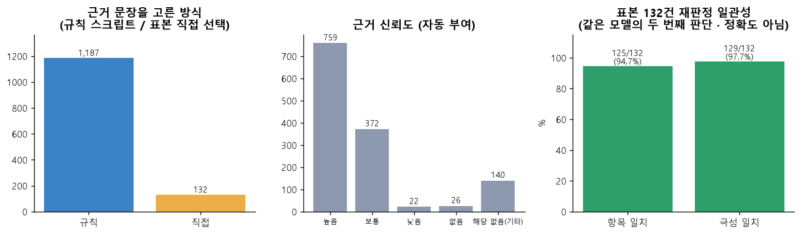

> **이 일치율은 "정확도"가 아니라 "일관성"입니다.** 같은 모델이 두 번 판단한 결과를 비교한 것이라 사람이 확인한 정답과는 다릅니다. 또 표본 재판정에서 **근거 문장을 규칙이 고른 경우의 약 10.8%는 라벨을 제대로 뒷받침하지 못했습니다.** 그래서 대시보드에서 근거 문장을 본문과 함께 보여 줍니다.

#### 결과: 항목별 분포

| 항목 | 긍정 | 부정 | 혼합 | 중립 | 판단 어려움 | 합계 | 부정 비율 | 긍정 비율 |
|---|---:|---:|---:|---:|---:|---:|---:|---:|
| 장착/고정 | 286 | 287 | 68 | 1 | 0 | 642 | 44.7% | 44.5% |
| 접힘 | 26 | 330 | 21 | 0 | 1 | 378 | 87.3% | 6.9% |
| 파손 | 11 | 150 | 0 | 0 | 1 | 162 | 92.6% | 6.8% |
| 열 | 17 | 54 | 2 | 1 | 1 | 75 | 72.0% | 22.7% |
| 휴대성 | 444 | 28 | 14 | 2 | 1 | 489 | 5.7% | 90.8% |
| 건조 결과 | 283 | 73 | 18 | 0 | 0 | 374 | 19.5% | 75.7% |
| 기타(전체 감정) | 104 | 18 | 3 | 12 | 3 | 140 | 12.9% | 74.3% |


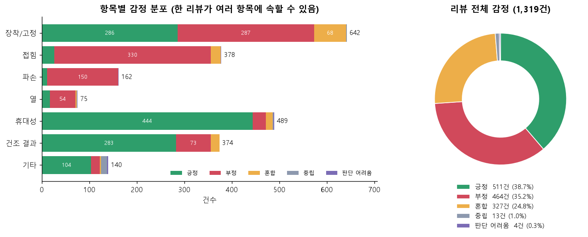

- **장착/고정이 가장 많이(642건) 언급되고 호불호가 갈립니다.** 긍정 44.5%, 부정 44.7%로 맞는 사람에게는 장점이고, 안 맞는 사람에게는 치명적인 문제입니다.
- **접힘과 파손은 거의 불만입니다.** 부정 비율이 접힘 87.3%, 파손 92.6%입니다.
- **휴대성은 거의 칭찬입니다.** 긍정 90.8%. 접힘 불만과 반대 방향의 신호입니다. (접으면 휴대는 편하지만, 쓰는 동안 접히는 것은 불만)
- **열**은 가장 드문 항목이지만 "드라이어가 녹았다" 같은 심각한 사례가 포함됩니다.
- 한 리뷰에 평균 1.6개 항목이 붙어 항목별 합계(위 2,120건)가 리뷰 수보다 큽니다. 항목에 해당하지 않은 **기타는 140건**(짧은 일반 칭찬, 배송·가격 이야기, 본문 없음 등)입니다.

리뷰 전체 감정과 가장 많이 나온 분류 조합입니다.

| 감정 | 리뷰 수 | 비율 |
|---|---:|---:|
| 긍정 | 511 | 38.7% |
| 부정 | 464 | 35.2% |
| 혼합 | 327 | 24.8% |
| 중립 | 13 | 1.0% |
| 판단 어려움 | 4 | 0.3% |


| 분류 조합 | 리뷰 수 |
|---|---:|
| 기타 | 140 |
| 장착_고정- | 133 |
| 접힘- | 91 |
| 장착_고정+ 휴대성+ | 79 |
| 휴대성+ | 71 |
| 건조_결과+ | 70 |
| 파손- | 59 |
| 장착_고정+ | 52 |
| 휴대성+ 건조_결과+ | 41 |
| 접힘- 휴대성+ | 34 |


#### 별점과 감정은 항상 일치하지 않는다

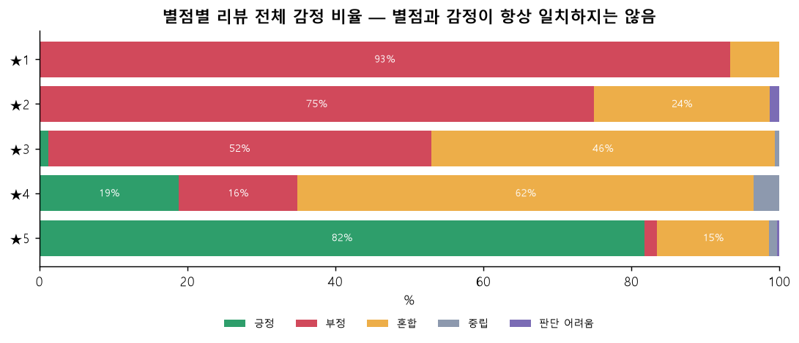

1점은 93%가 부정이지만, **4점 리뷰의 62%는 "혼합"** 입니다. 높은 별점을 준 사용자도 접힘·장착 문제를 같이 적는 경우가 많다는 뜻이라, 별점 평균만으로는 불만이 보이지 않습니다.

#### 분류 근거 예시

| 리뷰 ID | 별점 | 분류 | 전체 감정 | 항목별 근거 문장(원문) |
|---|---|---|---|---|
| AB0049440 | ★1 | 장착_고정- 파손- | 부정 | **장착/고정**: "Tried to stretch it over my hair dryer and it tore, and it’s too big for a mini hair dryer." <br> **파손**: "Tried to stretch it over my hair dryer and it tore, and it’s too big for a mini hair dryer." |
| AB0027160 | ★5 | 휴대성+ | 긍정 | **휴대성**: "folds flat for easy storage" |
| AB0028687 | ★1 | 장착_고정- 접힘- 열- 건조_결과- | 부정 | **장착/고정**: "has to be forcefully stretched over hair dryer nosel" <br> **접힘**: "it collapses as you try to use it" <br> **열**: "the silicon gets so hot that you can't even try to put back on until it cools down" <br> **건조 결과**: "can't use on roots /scalp" |
| AB0002033 | ★5 | 장착_고정+ | 긍정 | **장착/고정**: "Works fantastic, I think it would fit almost any dryer because it's flexible and molds to the shape of your dryer." |


#### 검토 필요 141건

판단이 모호한 리뷰는 분류를 지우지 않고 **검토 필요**로 남겼습니다.

| 검토 사유 | 리뷰 수 |
|---|---:|
| 근거 부족 | 48 |
| 별점-내용 불일치 | 37 |
| 기타 재확인 | 30 |
| 장문 부분 판독 | 20 |
| 비영어 | 9 |
| 모호 표현 | 5 |
| 직접 판독 모호 | 4 |
| 배송 미수령 | 1 |
| 반어 표현 | 1 |
| 본문 없음 | 1 |


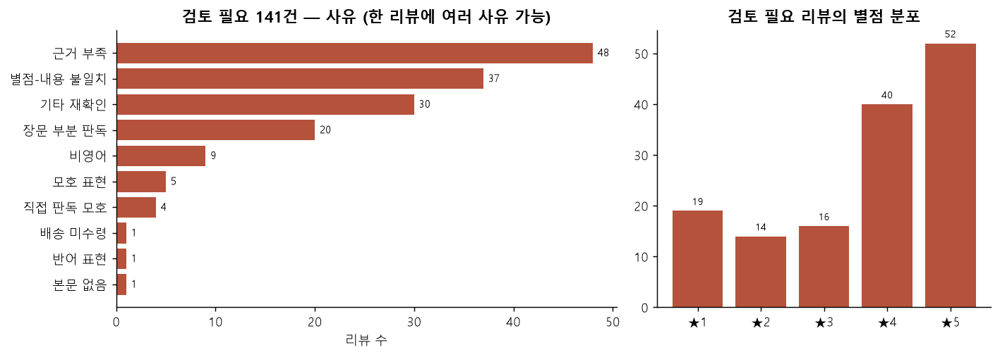

"별점-내용 불일치"에는 5점을 줬지만 "This is the worst diffuser. It collapses…"라고 쓴 사례처럼 **별점 입력 자체가 의심되는 리뷰**가 섞여 있습니다. 분류가 틀렸다기보다 별점과 본문이 어긋난 경우입니다.

### 1-7. 리뷰 검토 대시보드 (Streamlit)

분류 결과를 사람이 검토할 수 있도록 만든 대시보드입니다. 항목별로 감정 파이차트와 리뷰 본문을 같이 보고, 근거 문장은 본문에서 강조 표시됩니다.

```bash
streamlit run 01_review_analysis/dashboard/review_dashboard.py
```

#### ① 개요 탭


- **왼쪽 사이드바(필터):** 별점 다중 선택, "검토 필요 리뷰만 보기" 체크, 제목·본문 키워드 검색. 필터는 **모든 탭에 동시에 적용**됩니다.
- **상단 지표 4개:** 리뷰 수(1,319), 항목 분류 건수(2,120), 검토 필요(141), 평균 별점(3.54). 필터를 바꾸면 값이 함께 바뀝니다.
- **탭:** 개요 / 장착·고정 / 접힘 / 파손 / 열 / 휴대성 / 건조 결과 / 기타 / 검토 필요.
- **항목별 감정 분포(가로 누적 막대):** 6개 항목과 기타를 감정별 색으로 나눠 비교합니다(긍정 초록, 부정 빨강, 혼합 주황, 중립 회색, 판단 어려움 보라).
- **리뷰 전체 감정(도넛):** 전체 리뷰의 감정 비율.
- **항목 × 감정 표(하단):** 같은 내용을 숫자로 확인하고 합계를 봅니다.

#### ② 항목 탭 — 장착/고정

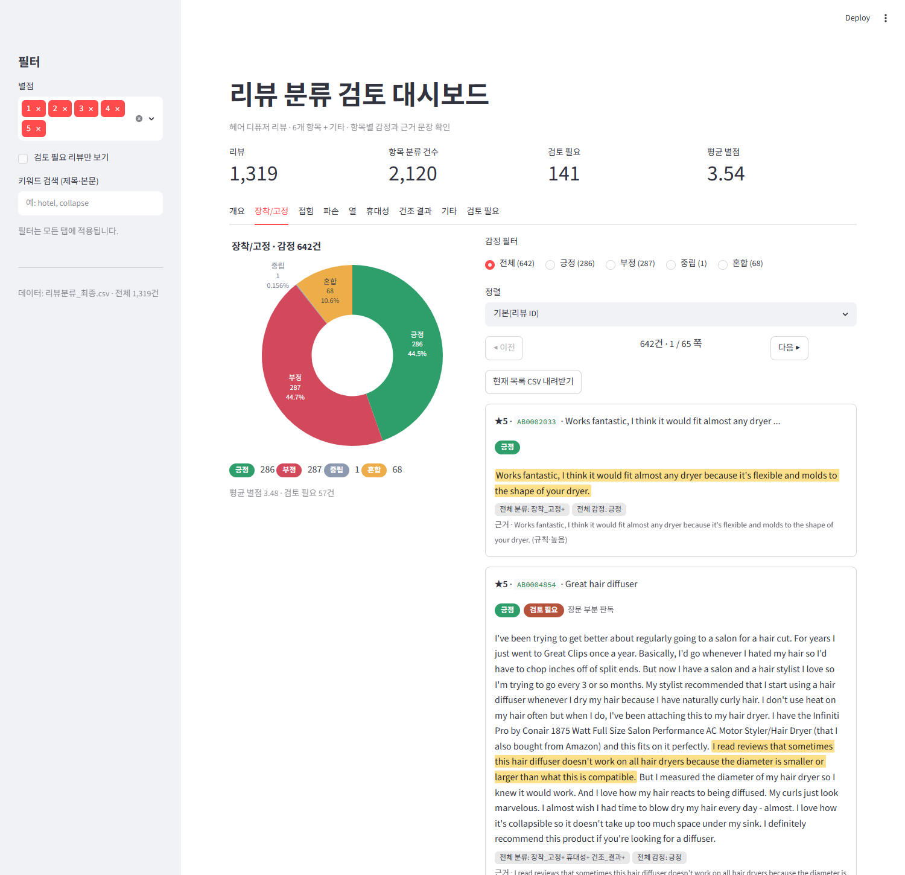

- **왼쪽:** 해당 항목의 감정 도넛(642건: 긍정 286 · 부정 287 · 혼합 68 · 중립 1), 감정별 건수 배지, 평균 별점과 검토 필요 건수.
- **오른쪽:** `감정 필터`(전체/긍정/부정/혼합…, 건수 표시), 정렬(리뷰 ID·별점 낮은순·높은순·검토 필요 먼저), 10건씩 페이지 이동, **현재 목록 CSV 내려받기**.
- **리뷰 카드:** 별점, 리뷰 ID, 제목, 감정 배지, (해당 시) **검토 필요 배지와 사유**, 본문. **근거 문장은 노란색으로 강조**되고 카드 아래에 `근거 · … (규칙·높음)`처럼 근거 출처와 신뢰도가 표시됩니다. 칩으로 리뷰의 전체 분류와 전체 감정도 보여 줍니다.

#### ③ 항목 탭 — 접힘 · 부정만 보기

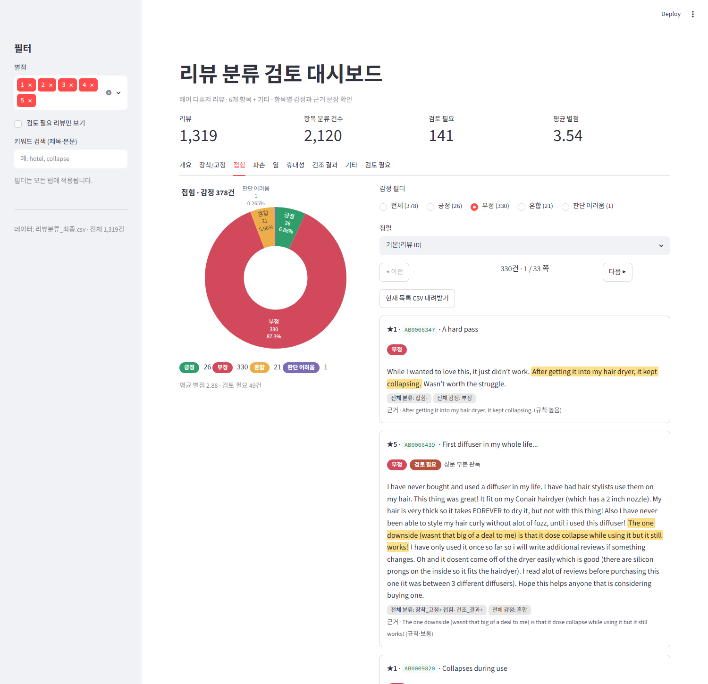

감정 필터를 "부정"으로 바꾼 화면입니다(330건, 33쪽). 도넛은 항목 전체의 감정 분포(부정 87.3%)를 계속 보여 주고, 오른쪽 목록만 부정 리뷰로 좁혀집니다. 첫 카드의 "kept collapsing"처럼 **근거 문장이 본문 안에서 강조**되어 라벨이 맞는지 바로 대조할 수 있습니다.

#### ④ 검토 필요 탭

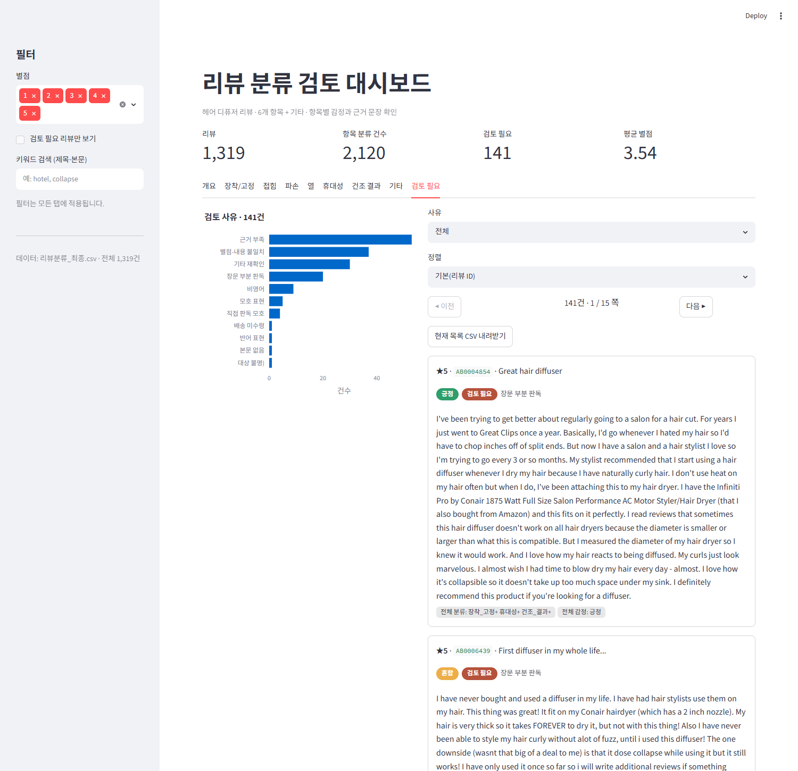

- **왼쪽:** 검토 사유별 건수(근거 부족, 별점-내용 불일치, 기타 재확인, 장문 부분 판독 등). 대시보드 막대는 사유가 **언급된 횟수**를 세고, 위 표는 **리뷰 수**(한 리뷰의 중복 사유는 1회)라서 숫자가 조금 다릅니다.
- **오른쪽:** 사유를 골라 해당 리뷰만 보고 CSV로 내려받을 수 있습니다. 긴 리뷰는 본문 전체와 근거 강조를 같이 보여 줘서 **사람이 최종 판단**하는 용도입니다.

---

## Part 2. 뉴스 제목 주제 분류 (KLUE-YNAT)

**질문:** 뉴스 제목만으로 7개 주제(IT과학·경제·사회·생활문화·세계·스포츠·정치)를 얼마나 맞출 수 있는가? 확신이 낮은 예측을 "보류"하면 정답률은 어떻게 달라지는가?

Part 1과 달리 **정답이 있는 데이터**라서 지도학습 분류 모델을 만들고 검증 데이터로 평가했습니다.

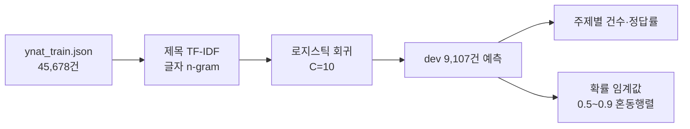

### 2-1. 데이터 점검과 입력 변수

| 점검 항목 | 값 |
|---|---|
| train 건수 | 45678 |
| dev 건수 | 9107 |
| train 제목 결측/공백 | 0 |
| dev 제목 결측/공백 | 0 |
| train 내 중복 제목(첫 건 제외) | 0 |
| dev 제목 중 train에도 있는 건수 | 0 |
| train 클래스 수 | 7 |
| dev 클래스 수 | 7 |
| 제외한 행 수 | 0 |


- **입력은 제목(`title`) 하나만** 사용했습니다. `predefined_news_category`, `annotations`, `url`, `date`, `guid`는 정답과 직접 연결되거나 식별자라서 입력에서 제외했습니다(**정답 누수 방지**).
- train/dev 사이에 겹치는 제목이 없어서(0건) 평가가 부풀려지지 않습니다.

### 2-2. 벡터화 방식 비교 (학습 데이터 3-fold 교차검증)

한국어는 조사·어미 변화가 많아 단어 단위보다 글자 단위가 유리할 수 있다고 보고, TF-IDF 방식 3가지를 **학습 데이터만으로** 교차검증해 비교했습니다. (검증 데이터는 선택에 쓰지 않았습니다.)

| TF-IDF 방식 | C | 교차검증 정답률 평균 | 표준편차 | 소요(초) |
|---|---|---|---|---|
| word(1-2) | 10 | 0.7873 | 0.0019 | 13 |
| char_wb(2-4) | 10 | 0.8515 | 0.0022 | 53 |
| word+char | 10 | 0.8431 | 0.0026 | 66 |


→ **글자 n-gram(`char_wb`, 2~4) 방식**이 단어 방식보다 약 6%p 높아 선택했습니다.

### 2-3. 검증 결과

| 항목 | 값 |
|---|---|
| TF-IDF 방식 | char_wb(2-4) |
| 로지스틱 회귀 C | 10.0 |
| 특성 수 | 197765 |
| 학습 건수 | 45678 |
| 검증 건수 | 9107 |
| 검증 정답률 | 0.8145 |
| 검증 macro F1 | 0.8154 |


| 주제 | 정밀도 | 재현율 | F1 | 검증 건수 |
|---|---:|---:|---:|---:|
| IT과학 | 0.717 | 0.767 | 0.741 | 554 |
| 경제 | 0.774 | 0.838 | 0.805 | 1,348 |
| 사회 | 0.855 | 0.783 | 0.817 | 3,701 |
| 생활문화 | 0.813 | 0.812 | 0.812 | 1,369 |
| 세계 | 0.777 | 0.848 | 0.811 | 835 |
| 스포츠 | 0.906 | 0.934 | 0.920 | 578 |
| 정치 | 0.764 | 0.842 | 0.801 | 722 |


**주제별 건수:** 예측 건수와 실제 건수를 비교했습니다.

| 주제 | 실제 건수 | 예측 건수 | 예측-실제 | 예측 비율(%) |
|---|---:|---:|---:|---:|
| IT과학 | 554 | 593 | 39 | 6.5 |
| 경제 | 1,348 | 1,458 | 110 | 16.0 |
| 사회 | 3,701 | 3,387 | -314 | 37.2 |
| 생활문화 | 1,369 | 1,366 | -3 | 15.0 |
| 세계 | 835 | 911 | 76 | 10.0 |
| 스포츠 | 578 | 596 | 18 | 6.5 |
| 정치 | 722 | 796 | 74 | 8.7 |
| 합계 | 9,107 | 9,107 | 0 | 100.0 |


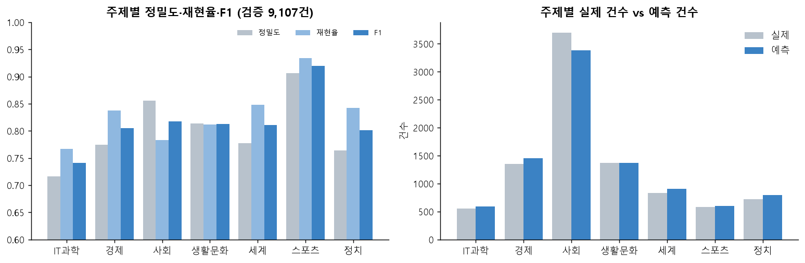

- 스포츠(F1 0.920)가 가장 잘 맞고, **IT과학(0.741)** 이 가장 어렵습니다.
- 가장 큰 주제인 사회는 **실제보다 314건 적게 예측**(재현율 78.3%)됐고, 틀린 예측은 경제(249건)·생활문화(192건)·정치(149건) 등으로 갈렸습니다. 사회 뉴스는 다른 주제와 경계가 모호합니다(해석은 혼동행렬에 근거한 추정이며 원인을 따로 검증하지는 않았습니다).

#### 혼동행렬 (행=실제, 열=예측)

| 실제＼예측 | 예측 IT과학 | 예측 경제 | 예측 사회 | 예측 생활문화 | 예측 세계 | 예측 스포츠 | 예측 정치 |
|---|---:|---:|---:|---:|---:|---:|---:|
| 실제 IT과학 | 425 | 36 | 67 | 14 | 7 | 5 | 0 |
| 실제 경제 | 34 | 1129 | 147 | 15 | 14 | 4 | 5 |
| 실제 사회 | 87 | 249 | 2897 | 192 | 108 | 19 | 149 |
| 실제 생활문화 | 29 | 22 | 144 | 1111 | 43 | 12 | 8 |
| 실제 세계 | 17 | 18 | 29 | 28 | 708 | 14 | 21 |
| 실제 스포츠 | 1 | 2 | 16 | 2 | 12 | 540 | 5 |
| 실제 정치 | 0 | 2 | 87 | 4 | 19 | 2 | 608 |


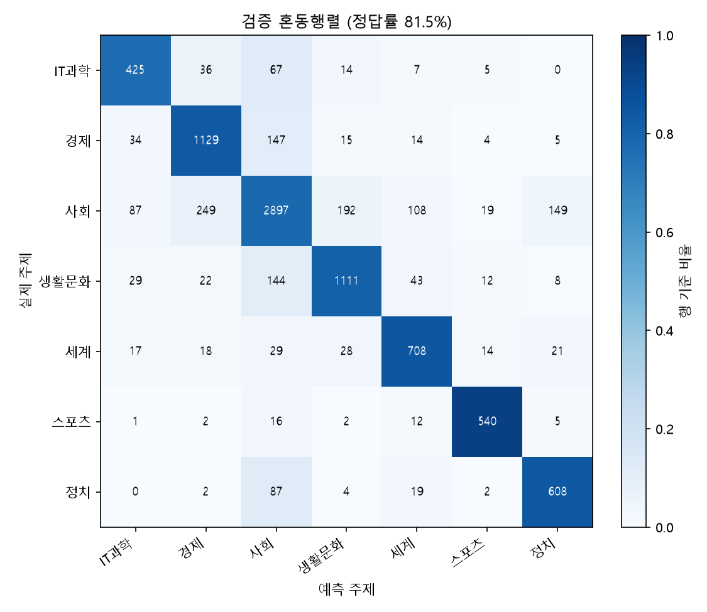

### 2-4. 확률 임계값을 바꾸면?

모델이 매긴 **가장 높은 클래스 확률이 임계값보다 낮으면 "보류"** 로 두고, 임계값을 0.5~0.9로 올려 가며 혼동행렬을 만들었습니다. 임계값을 높이면 확신하는 예측만 남아 정답률은 오르지만, 사람이 따로 봐야 할 보류 건수가 늘어납니다.

| 임계값 | 분류 건수 | 보류 건수 | 분류 비율(%) | 분류된 건의 정답률(%) | 전체 정답률(보류=오답, %) |
|---:|---:|---:|---:|---:|---:|
| 0.0 | 9,107 | 0 | 100.0 | 81.5 | 81.5 |
| 0.5 | 7,758 | 1,349 | 85.2 | 86.6 | 73.7 |
| 0.6 | 6,830 | 2,277 | 75.0 | 89.5 | 67.1 |
| 0.7 | 5,943 | 3,164 | 65.3 | 92.0 | 60.0 |
| 0.8 | 4,938 | 4,169 | 54.2 | 93.7 | 50.8 |
| 0.9 | 3,586 | 5,521 | 39.4 | 95.7 | 37.7 |


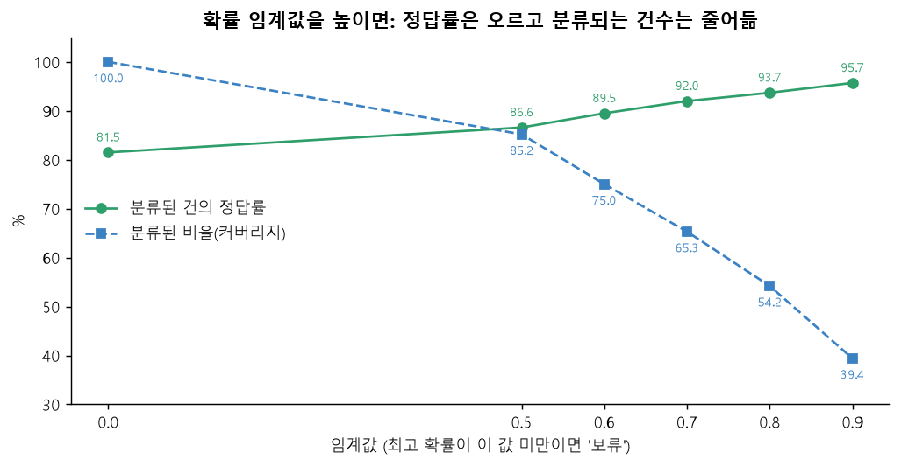

- 임계값 **0.7**에서 분류된 건의 정답률은 92.0%이지만 **전체의 34.7%(3,164건)가 보류**됩니다. **0.9**에서는 정답률 95.7%에 보류가 60.6%입니다.
- 마지막 열(보류를 오답으로 칠 때의 전체 정답률)은 임계값이 높을수록 오히려 떨어집니다. **"얼마나 틀려도 되는가"와 "얼마나 사람이 확인할 수 있는가"의 균형**으로 임계값을 정해야 합니다.

보류가 어느 실제 주제에서 많이 생기는지입니다(실제 주제 기준).

| 임계값 | IT과학 | 경제 | 사회 | 생활문화 | 세계 | 스포츠 | 정치 |
|---:|---:|---:|---:|---:|---:|---:|---:|
| 0.5 | 88 | 151 | 720 | 230 | 77 | 35 | 48 |
| 0.6 | 147 | 266 | 1,199 | 347 | 152 | 67 | 99 |
| 0.7 | 198 | 372 | 1,653 | 465 | 215 | 105 | 156 |
| 0.8 | 257 | 505 | 2,158 | 582 | 286 | 156 | 225 |
| 0.9 | 344 | 680 | 2,781 | 769 | 414 | 213 | 320 |


임계값별 혼동행렬(보류 열 포함)은 아래 그림에 모아 두었습니다.

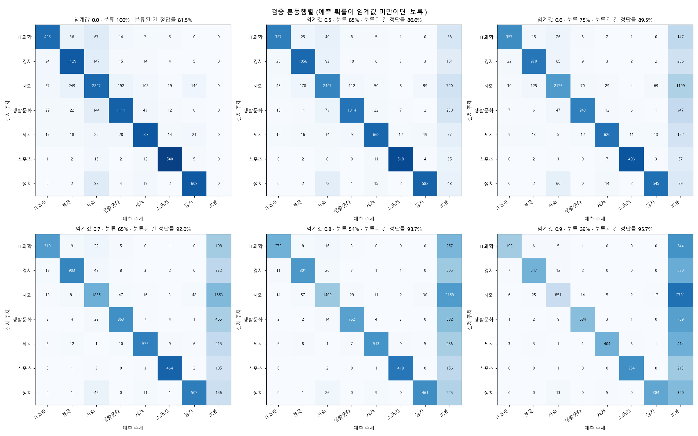

실제 주제 대비 보류 비율은 사회(0.5에서 19%)·생활문화(17%)·IT과학(16%)에서 높고 스포츠(6%)에서 가장 낮습니다. 

사용 환경(`environment.csv`):

| 패키지 | 버전 |
|---|---|
| python | 3.14.6 |
| scikit-learn | 1.9.0 |
| pandas | 2.3.3 |
| numpy | 2.5.0 |
| matplotlib | 3.11.0 |
| random_state | 42 |


```bash
# 데이터 내려받은 뒤(02_news_classification/data/raw/ynat_train.json, ynat_dev.json)
python 02_news_classification/analysis/01_tfidf_logreg.py
python 02_news_classification/analysis/02_threshold_confusion.py
```

---

## Part 3. RAG FAQ 챗봇 + LLM Wiki

**질문:** 제품 매뉴얼·FAQ만 근거로 답하고, **출처를 보여 주며, 모르는 것은 모른다고 말하는** FAQ 챗봇을 API 비용 없이 만들 수 있는가?

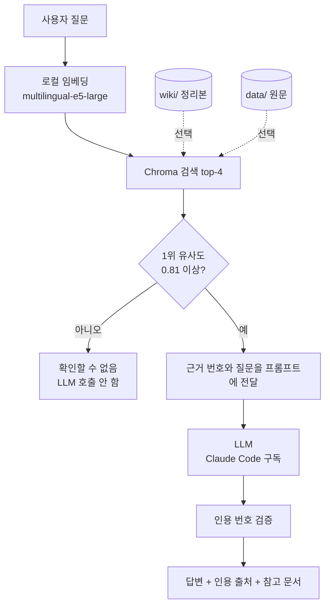

### 3-1. 문서 처리와 색인

| 항목 | 설정 |
|---|---|
| 원문 | 매뉴얼(`.md`)은 제목(`#`·`##`·`###`) 단위로 나눠 어느 장·절에서 왔는지 메타데이터에 저장, FAQ(`.csv`)는 한 행이 한 문서 |
| 청킹 | 500자, 겹침 100자 → **30조각** |
| 임베딩 | `intfloat/multilingual-e5-large` (무료·로컬, 1024차원, 문서 `passage: `·질문 `query: ` 접두어, 벡터 정규화) |
| 벡터DB | Chroma(로컬 저장) |
| 유사도 | 코사인 = 1 − 거리/2 |

### 3-2. 임베딩 모델 비교 (무료·로컬 모델만)

OpenAI 같은 유료 임베딩 대신 **무료 로컬 모델 3종**을 같은 조각·같은 질문으로 비교했습니다. 질문은 **문서에 답이 있는 질문 36개**(문서 문장을 베끼지 않고 구어체로 작성)와 **문서에 없는/무관한 질문 10개**입니다.

| 모델 | Recall@1 | Recall@3 | Recall@4 | MRR | 관련질문 1위 유사도 최소 | 없는내용 1위 유사도 최대 | 관련/없음 구분 AUC | 모델 로드(초) | 차원 |
|---|---:|---:|---:|---:|---:|---:|---:|---:|---:|
| MiniLM-L12 (128토큰) | 0.417 | 0.583 | 0.694 | 0.546 | 0.23 | 0.61 | 0.54 | 5.90 | 384 |
| mpnet-base (128토큰) | 0.667 | 0.833 | 0.833 | 0.771 | 0.39 | 0.62 | 0.84 | 6.80 | 768 |
| mpnet-base (512토큰) | 0.667 | 0.833 | 0.833 | 0.770 | 0.39 | 0.62 | 0.84 | 6.40 | 768 |
| e5-large (512토큰) | 0.861 | 0.972 | 0.972 | 0.917 | 0.81 | 0.88 | 0.85 | 148.30 | 1024 |


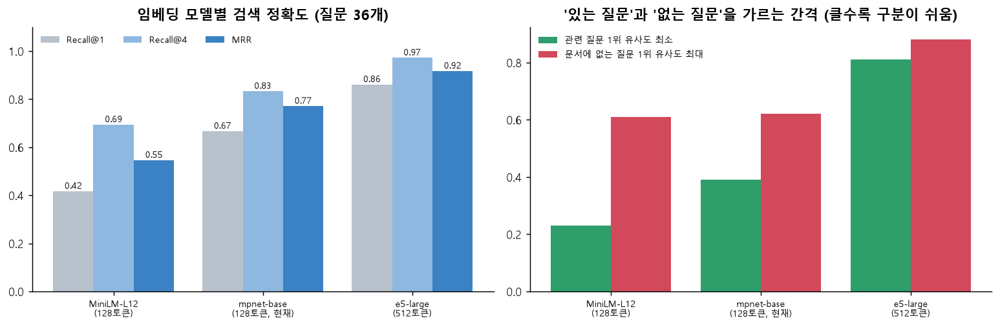

- **Recall@4**: 정답 조각이 상위 4위 안에 든 비율. **e5-large가 97%로 가장 높고**(MiniLM 69% → mpnet 83% → e5 97%), 1위 적중률도 86%로 가장 높아 채택했습니다.
- 모델을 바꾸는 데 비용은 들지 않지만 **최초 1회 약 2GB 모델 다운로드와 로드 시간(약 148초)** 이 듭니다.
- **중요한 발견:** e5-large에서 "있는 질문"의 1위 유사도 최소(0.81)와 "문서에 없는 질문"의 최대(0.88)가 **겹칩니다.** 같은 분야인데 문서에 없는 질문(예: "필터 가격")은 유사도가 높게 나와서, **유사도 기준만으로는 "모른다"를 가려낼 수 없습니다.** 그래서 아래 3중 장치를 두었습니다.

### 3-3. 벡터DB 비교: Chroma vs FAISS

실제 데이터(30조각, 질문 36개)와 가상 데이터 규모 실험(1천·1만·5만 개)으로 비교했습니다.

**실제 데이터:**

| 벡터 DB | Recall@1 | Recall@4 | MRR | 상위4 결과가 기준과 같은 질문 비율 | 질문당 검색(ms) |
|---|---:|---:|---:|---:|---:|
| 전수 비교(numpy, 기준) | 0.861 | 0.972 | 0.912 | 1.00 | 0.082 |
| Chroma (HNSW) | 0.861 | 0.972 | 0.912 | 1.00 | 3.625 |
| FAISS (Flat, 정확 검색) | 0.861 | 0.972 | 0.912 | 1.00 | 0.047 |


세 방식의 검색 결과가 **모든 질문에서 같습니다**(상위 4개 일치 100%). 이 규모에서는 정확도 차이가 없고 속도 차이(수 ms 이내)도 체감되지 않습니다.

**규모 실험(가상 데이터):**

| 문서 수 | 벡터 DB | 색인(초) | 질문당 검색(ms) | 정확도(Recall@10) | 저장 용량(MB) |
|---|---:|---:|---:|---:|---:|
| 1,000 | FAISS Flat(정확) | 0.00 | 0.19 | 1.000 | 4.1 |
| 1,000 | FAISS HNSW(근사) | 0.53 | 0.06 | 1.000 | 4.4 |
| 1,000 | Chroma(기본 HNSW) | 0.59 | 3.03 | 1.000 | 9.2 |
| 10,000 | FAISS Flat(정확) | 0.02 | 0.69 | 1.000 | 41.0 |
| 10,000 | FAISS HNSW(근사) | 3.71 | 0.13 | 1.000 | 43.7 |
| 10,000 | Chroma(기본 HNSW) | 4.94 | 2.77 | 1.000 | 68.8 |
| 50,000 | FAISS Flat(정확) | 0.11 | 5.47 | 1.000 | 204.8 |
| 50,000 | FAISS HNSW(근사) | 14.71 | 0.08 | 0.999 | 218.4 |
| 50,000 | Chroma(기본 HNSW) | 20.17 | 1.49 | 1.000 | 242.0 |


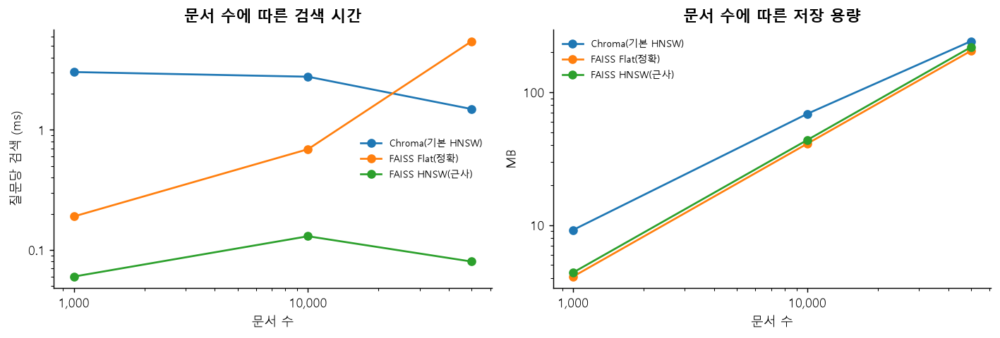

문서가 많아지면 FAISS Flat(정확 검색)은 느려지고(5만 개에서 5.47ms) FAISS HNSW(근사)가 가장 빨랐습니다(0.08ms, Recall@10 0.999). 기능 점검(메타데이터 필터, 문서 삭제, 저장·불러오기)은 **둘 다 통과**했고, Chroma는 자동 저장·FAISS는 `save_local`로 직접 저장하는 차이가 있었습니다. 이 프로젝트는 문서가 30조각이라 속도·정확도 이점이 없어 **Chroma를 유지**했습니다. 문서가 수만 건 이상으로 커지면 다시 검토할 대상입니다.

### 3-4. "모르면 모른다고 답하기" — 3중 장치

1. **검색 단계(`no_retrieval`):** 1위 유사도가 기준(0.80 / 위키 모드 0.81) 미만이면 LLM을 부르지 않고 바로 "확인할 수 없습니다"로 답합니다. (완전히 무관한 질문을 걸러냄)
2. **프롬프트 단계(`unanswerable`·`partial`):** LLM에게 "근거에 없으면 정해진 문장만 답하고, 일부만 확인되면 확인된 부분만 번호와 함께 답한 뒤 마지막에 '그 외 ○○은 확인할 수 없다'고 쓰라"고 지시합니다. 근거 안에 지시문이 있어도 따르지 않도록 했습니다.
3. **검증 단계(`ungrounded`):** 답변에 근거 번호(`[1]`)가 하나도 없으면 신뢰하지 않고 "확인할 수 없음"으로 바꿉니다. 존재하지 않는 번호는 지웁니다. 근거 번호 없이 긴 문장이 나오면 **"근거 번호가 없는 문장" 경고**를 화면에 띄웁니다.

답변 상태는 `근거 확인됨 / 일부만 확인됨 / 문서에서 확인할 수 없음 / 관련 문서 없음 / 근거 번호가 없어 답변 차단`으로 구분해 화면에 표시합니다.

### 3-5. LLM 연결 — 비용을 쓰지 않는 방식

`.env`의 `LLM_BACKEND`로 고릅니다. 키를 코드나 저장소에 넣지 않습니다(`.env`는 `.gitignore`).

| 값 | 방식 | 비용 |
|---|---|---|
| `claude_code` (기본) | 로그인된 Claude Code 구독을 `claude -p`로 호출(도구·세션 저장 끔) | API 키·API 과금 없음(구독 한도 사용) |
| `api` | Anthropic API 키(`ANTHROPIC_API_KEY`)로 호출 | 사용량만큼 과금 |
| `mock` | LLM 없이 검색된 첫 근거를 발췌 | 화면·출처 표시 **테스트용** |

### 3-6. LLM Wiki — 문서를 한 번 정리해 두는 지식 층

[Andrej Karpathy의 LLM Wiki](https://gist.github.com/karpathy/442a6bf555914893e9891c11519de94f) 아이디어를 따랐습니다. 질문할 때마다 원문 조각을 새로 찾는 대신, **LLM이 원문을 읽고 서로 연결된 마크다운 위키로 정리해 두고 계속 갱신**합니다.

| 층 | 역할 | 이 프로젝트 |
|---|---|---|
| 원본 | 고치지 않는 소스 | `03_rag_faq_chatbot/data/` |
| 위키 | LLM이 만들고 관리하는 마크다운 | `03_rag_faq_chatbot/wiki/` (21페이지) |
| 스키마 | 구조·작업 절차 | `03_rag_faq_chatbot/CLAUDE.md` |

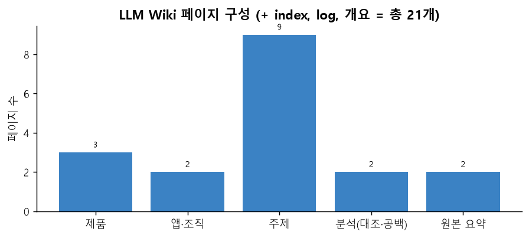

| 종류 | 파일 | 제목 |
|---|---|---|
| 제품 | `wiki/products/HB-AC300_스마트_에어컨.md` | 한빛 스마트 에어컨 HB-AC300 |
| 제품 | `wiki/products/HB-AP120_스마트_공기청정기.md` | 한빛 스마트 공기청정기 HB-AP120 |
| 제품 | `wiki/products/HB-PL10_스마트_플러그.md` | 한빛 스마트 플러그 HB-PL10 |
| 앱·조직 | `wiki/entities/고객센터.md` | 한빛 고객센터 |
| 앱·조직 | `wiki/entities/한빛홈_앱.md` | 한빛홈(HanbitHome) 앱 |
| 주제 | `wiki/topics/AS_접수.md` | A/S 접수 |
| 주제 | `wiki/topics/냉방이_약할_때.md` | 냉방이 약할 때 |
| 주제 | `wiki/topics/보증_기간.md` | 품질보증 기간 |
| 주제 | `wiki/topics/에어컨_누수와_결로.md` | 에어컨 누수와 결로 |
| 주제 | `wiki/topics/오프라인_오류와_재등록.md` | 오프라인 오류와 재등록 |
| 주제 | `wiki/topics/초기_설치와_Wi-Fi_연결.md` | 초기 설치와 Wi-Fi 연결 |
| 주제 | `wiki/topics/표시등_색상.md` | 공기청정기 표시등 색상 |
| 주제 | `wiki/topics/필터_관리.md` | 필터 관리 (에어컨 청소, 공기청정기 교체) |
| 주제 | `wiki/topics/환불과_교환.md` | 환불과 교환 |
| 분석 | `wiki/analysis/문서_간_일치_점검.md` | 문서 간 일치 점검 (매뉴얼 vs FAQ) |
| 분석 | `wiki/analysis/확인되지_않는_정보.md` | 확인되지 않는 정보 (문서에 없는 내용) |
| 원본 요약 | `wiki/sources/제품_FAQ.md` | 원본 요약: 제품_FAQ.csv |
| 원본 요약 | `wiki/sources/제품_매뉴얼.md` | 원본 요약: 제품_매뉴얼.md |


- `index.md`(전체 목록, 질문 전에 먼저 읽음)와 `log.md`(시간순 작업 기록)를 두었고, 페이지끼리 `[[링크]]`(Obsidian 방식)로 연결합니다.
- **모든 사실 문장 끝에 원문 위치를 적습니다.** 예: `(출처: 제품_매뉴얼.md §3.2, 제품_FAQ.csv #1)` — `§`는 매뉴얼 절 번호, `#`는 FAQ 행 번호입니다.
- **두 원본을 대조**해 모순이 없음을 확인하고(FAQ는 매뉴얼의 요약), 원문에 없는 정보(고객센터 전화번호, 교체 필터 가격, 유상 수리비 등)는 `확인되지_않는_정보`에 모았습니다. 챗봇이 이런 질문에 "확인할 수 없다"고 답해야 한다는 목록이기도 합니다.

#### 위키 점검(lint): `wiki_lint.py`

위키가 원본과 어긋나거나 깨지지 않았는지 기계적으로 점검합니다.

| 구분 | 점검 내용 |
|---|---|
| 오류 | frontmatter 누락, 깨진 `[[링크]]`, **존재하지 않는 원문 절·FAQ 번호 인용**, **원문에 없는 숫자·단위** |
| 경고 | 고아 페이지, 색인에 없는 페이지, 위키가 인용하지 않은 원문 절·FAQ 행, 로그 형식 |

첫 점검에서 오류 1건("6~12개월"이 원문의 "6개월에서 12개월"과 다름)과 고아 페이지 2개가 나와 고쳤고, 현재 **오류 0건, 경고 0건**(인용된 매뉴얼 본문 절 14/14, FAQ 15/15)입니다. 단, 스크립트는 형식과 숫자만 보므로 **문장 의미의 모순은 잡지 못합니다.**

### 3-7. 위키를 챗봇에 연결

`ingest_wiki.py`가 위키의 내용 페이지(제품·앱·주제·개요)를 제목 단위로 **50조각**으로 나눠 같은 Chroma 폴더의 별도 컬렉션(`wiki`)에 저장합니다(index·log·sources·analysis는 관리용이라 제외). 챗봇은 `KNOWLEDGE_SOURCE`(wiki 기본 / raw)로 **위키와 원문 중 하나**를 검색하고, 화면에서도 바꿀 수 있습니다.

위키 모드의 유사도 기준값은 질문 19개로 측정해 정했습니다.

| 질문 종류 | 질문 수 | 최소 | 최대 |
|---|---:|---:|---:|
| 관련 질문 | 10 | 0.837 | 0.904 |
| 무관한 질문 | 4 | 0.754 | 0.788 |
| 문서에 없는 질문(같은 분야) | 5 | 0.785 | 0.866 |


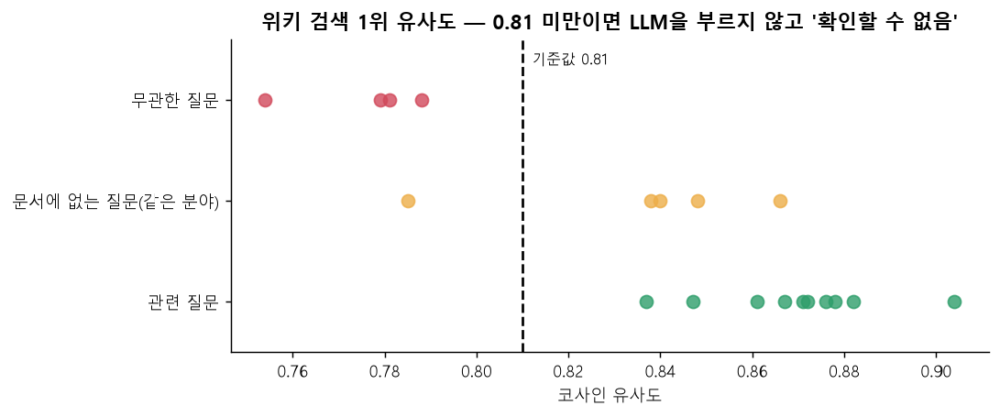

관련 질문은 최소 0.837, 무관한 질문은 최대 0.788이라 **기준값 0.81**로 갈립니다. 같은 분야인데 문서에 없는 질문은 0.785~0.866으로 기준을 넘는 경우가 있어 역시 LLM 거절·인용 검증이 처리합니다.

### 3-8. 챗봇 화면 (Streamlit)

```bash
streamlit run 03_rag_faq_chatbot/app.py
```

#### ① 첫 화면

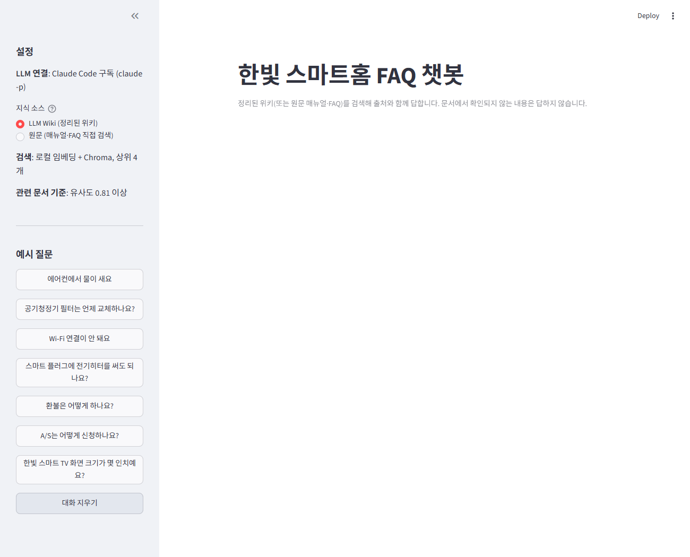

- **왼쪽 사이드바:** 현재 **LLM 연결 방식**(Claude Code 구독 / API / 테스트용), **지식 소스 선택**(LLM Wiki ↔ 원문), 검색 설정(로컬 임베딩 + Chroma, 상위 4개)과 **관련 문서 기준 유사도**, **예시 질문 버튼 7개**(마지막은 문서에 없는 "스마트 TV" 질문), `대화 지우기`.
- **본문:** 채팅 입력창에 질문을 입력합니다. 테스트 모드일 때는 "LLM 답변이 아닙니다"라는 경고가 사이드바에 표시됩니다.

#### ② 근거가 확인된 답변 — "에어컨에서 물이 새요"


- **상태 배지(초록 "근거 확인됨")** 아래에 답변이 나오고, 문장 끝마다 **근거 번호 `[3]`, `[4]`** 가 붙습니다. 어느 소스로 답했는지도 작게 표시됩니다.
- **출처(답변에 인용된 문서)** 칸에서 번호별로 **실제 위키 페이지·절·유사도**(`wiki/에어컨_누수와_결로.md › 누수 점검 순서 · 유사도 0.86`)와 **인용된 조각의 원문 텍스트**를 펼쳐 볼 수 있습니다. 조각 안의 `(출처: 제품_매뉴얼.md §3.2, 제품_FAQ.csv #1)`로 **원본 문서 위치까지 거슬러 올라갈 수 있습니다.**
- 아래 접힌 칸 "검색됐지만 인용되지 않은 참고 문서"에는 검색은 됐지만 답변에 쓰이지 않은 조각이 있어 **LLM이 무엇을 골랐는지** 확인할 수 있습니다.

#### ③ 일부만 확인되는 질문 — "공기청정기 필터 교체 시기와 가격 알려줘"

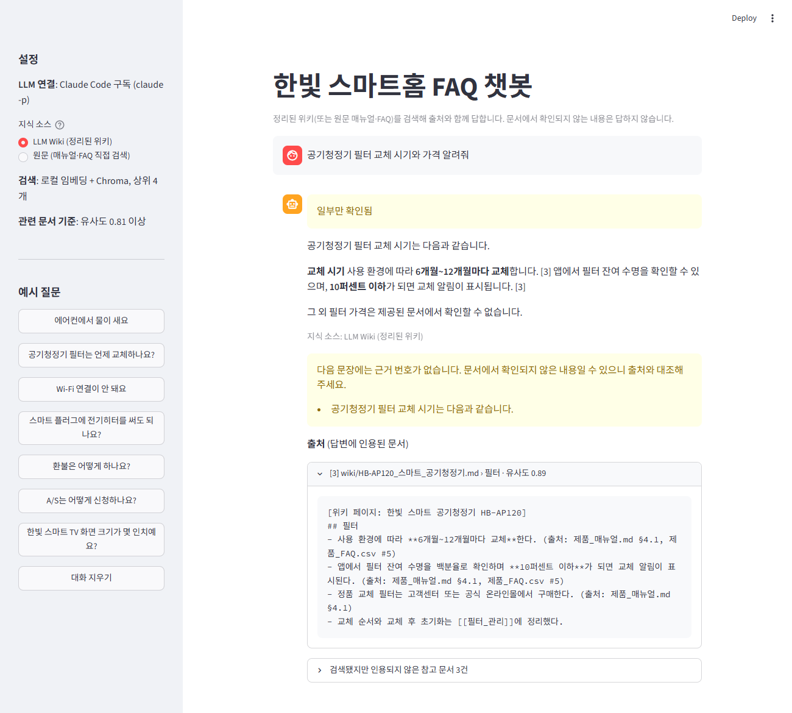

- 노란 **"일부만 확인됨"** 배지. 교체 시기(6개월~12개월)와 교체 알림(10퍼센트 이하)은 근거와 함께 답하고, **가격은 문서에 없으므로 "확인할 수 없습니다"** 라고 분리해서 말합니다. 문서에 없는 정보를 지어내지 않습니다.
- 인용된 위키 조각에 원문 출처(`제품_매뉴얼.md §4.1, 제품_FAQ.csv #5`)가 그대로 보입니다.

#### ④ 문서에 없는 질문 — "고객센터 전화번호가 뭐예요?"

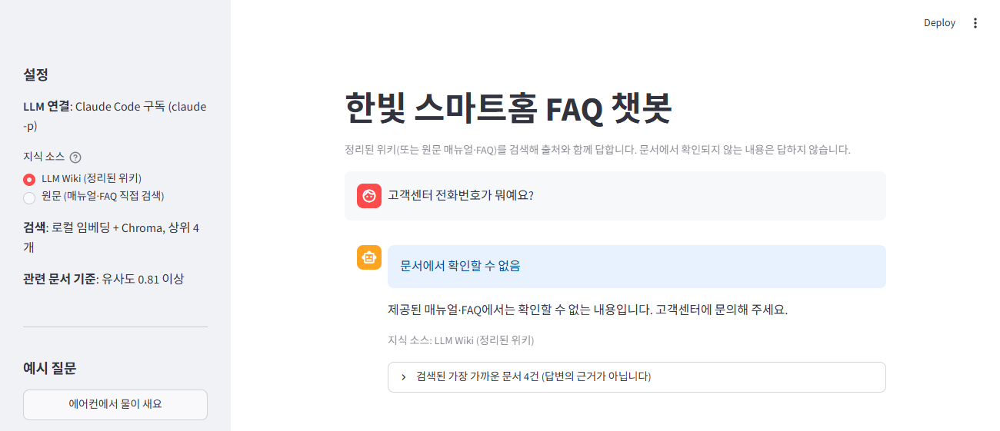

- 파란 **"문서에서 확인할 수 없음"** 배지와 정해진 안내 문장만 나옵니다. 근거가 없으므로 출처는 비어 있고, 참고용으로 "검색된 가장 가까운 문서 4건(**답변의 근거가 아닙니다**)"만 접어서 보여 줍니다. 위키의 `확인되지_않는_정보`에 적어 둔 항목과 일치하는 동작입니다.
- 완전히 무관한 질문("오늘 날씨 어때?")은 유사도가 기준 미만이라 **LLM을 호출하지 않고** "관련 문서 없음"으로 답합니다.

위키 모드로 실제 LLM(Claude Code 구독)에 4개 질문을 돌린 결과입니다.

| 질문 | 상태 |
|---|---|
| 에어컨에서 물이 새요 | 근거 확인됨 (위키 3곳 인용) |
| 공기청정기 필터 교체 시기와 가격 알려줘 | 일부만 확인됨 |
| 고객센터 전화번호가 뭐예요? | 문서에서 확인할 수 없음 |
| 오늘 날씨 어때? | 관련 문서 없음 (LLM 미호출) |

---

## 실행 방법

### 준비
```bash
python -m venv .venv && .venv\Scripts\activate      # (macOS/Linux: source .venv/bin/activate)
pip install -r requirements.txt
```

### Part 1: 리뷰 검토 대시보드
```bash
streamlit run 01_review_analysis/dashboard/review_dashboard.py
```

### Part 2: 뉴스 분류
KLUE-YNAT의 `ynat_train.json`, `ynat_dev.json`을 `02_news_classification/data/raw/`에 두고 실행합니다(해시는 `source_info.json`).
```bash
python 02_news_classification/analysis/01_tfidf_logreg.py
python 02_news_classification/analysis/02_threshold_confusion.py
```

### Part 3: RAG 챗봇
```bash
cd 03_rag_faq_chatbot
copy .env.example .env             # (macOS/Linux: cp) 필요하면 LLM_BACKEND 등을 수정
python ingest.py                   # 원문 색인 (최초 1회, e5-large 모델 약 2GB 내려받음)
python ingest_wiki.py              # 위키 색인 (위키를 고칠 때마다 다시)
python wiki_lint.py                # 위키 점검
streamlit run app.py
```
- 기본 LLM은 **로그인된 Claude Code 구독**입니다. 먼저 터미널에서 `claude auth login`으로 로그인하세요. API 키를 쓰려면 `.env`에 `LLM_BACKEND=api`, `ANTHROPIC_API_KEY=...`를 적습니다(**이 파일을 저장소에 올리지 마세요**).
- LLM 없이 화면만 확인하려면 `LLM_BACKEND=mock`.

### 차트·캡처 다시 만들기
```bash
python tools/make_figures.py       # docs/img/fig*.png
python tools/capture_screens.py    # 두 앱을 먼저 실행한 상태에서 docs/img/dash_*.png, bot_*.png
```

---

## 한계와 주의

**Part 1 (리뷰 분석)**
- **상품 1개의 리뷰**(1,319건)라서 다른 제품이나 전체 소비자로 일반화할 수 없습니다.
- 분류 라벨은 **LLM 한 모델이 붙였고 사람이 교차 검증하지 않았습니다.** 표본 재판정의 일치율(항목 94.7%)은 같은 모델의 일관성이지 정확도가 아닙니다. 정확도를 알려면 사람이 표본을 따로 라벨링해야 합니다.
- **근거 문장의 약 10%는 라벨을 제대로 뒷받침하지 못합니다**(규칙 선택). 중요한 건은 본문과 함께 확인하세요.
- 800자를 넘는 리뷰는 앞부분만 읽었고(약 2%), 스페인어 등은 번역해 판단했습니다.
- 파라미터 탐색의 **종합 점수 가중치는 임의로 정한 값**이고 일관성 지표는 짧은 문장에서 모두 음수라 상대 비교용입니다. 그래서 점수 1위가 아니라 시드 안정성이 높은 조합을 추천했습니다.
- 분석 코드(정제·BERTopic·튜닝·분류)는 스크립트로 남기지 못해 **결과 파일로만 재현·검증**할 수 있습니다.

**Part 2 (뉴스 분류)**
- 제목만 쓴 선형 모델의 기준선(정답률 81.5%)입니다. 임계값·설정은 검증 데이터로 본 것이라 새 데이터에서는 달라질 수 있습니다.

**Part 3 (RAG)**
- 매뉴얼·FAQ는 **가상 샘플 문서**이고 실제 제품과 무관합니다.
- 평가 질문은 36+10개로 적어서 모델·벡터DB 비교는 **경향을 보는 수준**입니다.
- 유사도 기준값은 이 문서 기준으로 측정한 값이라 문서가 바뀌면 다시 측정해야 합니다.
- **위키 모드가 원문 모드보다 정확하다는 것은 측정하지 않았습니다.** 위키 페이지는 LLM이 쓴 것이라 오류가 있으면 답변도 틀립니다(답변의 `§`·`#` 번호로 원문과 대조하거나 화면에서 "원문" 모드로 바꿔 비교).
- 위키를 고치면 `ingest_wiki.py`를 다시 실행해야 챗봇에 반영됩니다.

**데이터 라이선스:** Amazon Reviews 2023과 KLUE는 각 제공처의 이용 조건을 따릅니다(KLUE 라이선스 파일 포함). 이 저장소에는 별도 라이선스를 지정하지 않았습니다.
